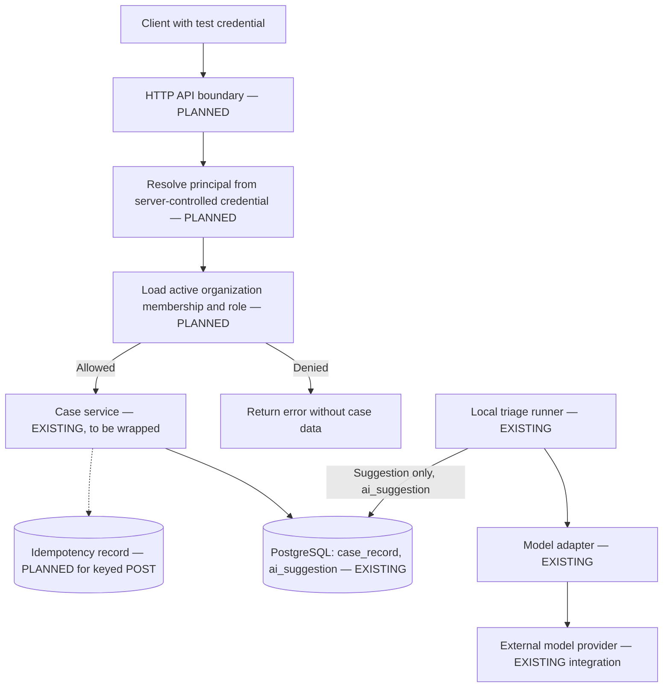

# Service Case API Contract — Initial Proposal

**Project:** Enterprise AI Service Operations & Intelligence Platform  
**Status:** **Design only. HTTP endpoints, authenticated principals, organization memberships, and idempotent creation are not implemented.**  
**Scope:** `POST /cases`, `GET /cases/{id}`, and `GET /cases`; secure request identity; organization-scoped access; case-creation retry semantics.  
**Evidence class:** Design only. Examples, response codes, and test scenarios below are not measured outcomes.

## 1. Governing Architecture Decisions

This contract must conform to the following [Architecture Decision Records](adr/README.md). Each row states what the decision requires of the API.

| ADR | Status | Implication for the API contract |
|---|---|---|
| [ADR-0001: PostgreSQL as the Authoritative Case Store](adr/0001-postgresql-authoritative-case-store.md) | Accepted | Case creation and retrieval operate against PostgreSQL as the authoritative store. API responses report the case state recorded there. |
| [ADR-0002: AI Suggestions Are Non-Authoritative](adr/0002-ai-suggestions-non-authoritative.md) | Accepted | `POST /cases` creates a case without requiring AI inference. AI output cannot authorize a request or change case state. |
| [ADR-0003: Application-Controlled Case State Transitions](adr/0003-application-controlled-case-transitions.md) | Accepted | The existing `transition_case()` function must not be exposed through an HTTP endpoint until authentication, tenant authorization, and approval checks exist. The service currently performs none of these checks. |
| [ADR-0004: Keyed Idempotent Case Creation](adr/0004-keyed-idempotent-case-creation.md) | **Proposed** | The retry contract for `POST /cases` ([section 5](#5-post-cases--create-a-case-planned)) is designed against this proposal, but it is **Proposed and not implemented**. Its unresolved response semantics are listed as candidates, not settled behavior. No part of this contract may claim that case creation is idempotent or duplicate-safe until the tests listed in the ADR have recorded observed results. |

**Accepted does not mean implemented.** ADR-0001 to ADR-0003 include requirements, such as access control and authorization, that the current code does not meet. See the [system context](system-context.md#4-capability-status) for current capability status.

## 2. Existing baseline and boundaries

The repository implements a local PostgreSQL `case_record` table and the Python functions `create_case`, `get_case`, and `transition_case` in [`src/case_service.py`](../src/case_service.py), alongside a separate AI triage CLI. `case_record` has a UUID primary key, an owning `organization_id`, title, description, status, version, and timestamps.

- The case service scopes queries by a **caller-supplied** organization UUID. It does **not** authenticate or authorize callers.
- `create_case()` creates a new row on each successful call. It is **not idempotent**.

See the [data model](data-model.md), [controlled case operations](case-operations.md), and [case creation semantics](case-creation-semantics.md).

The planned HTTP layer must not expose these functions directly without a verified actor and an authorization decision. This document is a contract for a future implementation, not evidence that the HTTP layer exists.

## 3. API design choices (proposed)

| Decision | Proposed initial rule | Reason |
|---|---|---|
| API shape | Resource-oriented JSON over HTTP; no frontend required | Small, reviewable business boundary |
| Case identifier | Database-generated UUID, unchanged over the case lifecycle | Stable row identity, independent of description or model output |
| Actor identity | `Authorization: Bearer <test-token>`, resolved through **server-controlled, test-only** credential configuration | A caller cannot assume another identity by sending an arbitrary user or organization header |
| Tenant selection | The client supplies a target `organization_id` for create and list. It is **not** proof of ownership; the server verifies membership and operation permission | Supports users who belong to several organizations, without trusting tenant IDs as credentials |
| Authorization | Deny by default unless the actor is active, has an applicable organization membership, and has a role that allows the action | Foreign keys and query predicates alone do not prove access rights |
| Case creation | `POST /cases` writes a case at `NEW`, version `1`, without invoking AI | An accepted case survives a separate AI outage ([ADR-0002](adr/0002-ai-suggestions-non-authoritative.md)) |
| Idempotency | Optional `Idempotency-Key` header; keyed creation is atomic per `(organization_id, operation, key)` | Prevents unintended duplicate cases after ambiguous response failures ([ADR-0004](adr/0004-keyed-idempotent-case-creation.md), Proposed) |
| Read single case | `GET /cases/{id}` checks the case's actual owner against the trusted actor's membership | A guessed UUID must not bypass the tenant boundary |
| List cases | `GET /cases?organization_id=<uuid>&limit=...&cursor=...`; authorization is applied before the scoped query | No implicit all-tenant listing |
| Case status changes | Out of scope for this contract; `transition_case` is not exposed as an unprotected endpoint | The transition service has no verified actor or approval ([ADR-0003](adr/0003-application-controlled-case-transitions.md)) |
| AI suggestions and approval | Out of scope; suggestions remain non-authoritative | A model cannot authorize an operation |

**The bearer token is a local demonstration mechanism.** It is not production OIDC, JWT validation, SSO, or a completed login implementation. The server must resolve each opaque token to a principal through internal fixtures or configuration that clients cannot edit. An arbitrary `X-User-Id`, `X-Actor-Id`, or `X-Org-Id` header, or a decoded but unverified token, is never proof of identity. Working tokens and other secrets must not be committed.

## 4. Trust-boundary sequence



**Request authority flows** from an authenticated actor, to a verified membership, to a permitted operation, to scoped database access. It never flows from a model response or an untrusted organization identifier. The planned HTTP and idempotency boundaries are labeled explicitly. The existing local triage runner, not the model adapter, persists non-authoritative suggestions, and it remains separate from HTTP case creation.

### Authorization rule (proposed)

Given a **verified** `actor_id`, an action (`case:create`, `case:read`, or `case:list`), and an organization:

1. Verify that the actor is active and allowed to use the application.
2. Obtain the actor's active membership and role in that organization from **server-owned data**, not from request claims.
3. Check that the role grants the action. The initial demonstration matrix is deliberately narrow:
   - `service_engineer` and `service_manager` can create, read, and list cases in their own member organizations.
   - `requester` may be allowed to create cases, but is not granted unrestricted reading or listing until per-case requester ownership and permissions are modeled.
   - `platform_administrator` is **not** automatically entitled to all customer data without an explicit decision.
4. When fetching by case ID, determine the case's actual `organization_id` and check membership. Never accept a claimed owner without verification.
5. Restrict every SQL read to the authorized scope, for example `WHERE c.id = :case_id AND c.organization_id = :authorized_org_id`. This predicate is defense in depth **after** membership is verified, not a replacement for it.
6. Do not expose cases or their existence outside the actor's scope. For a single case, return a generic `404` for both nonexistent and inaccessible IDs. For an explicitly requested forbidden organization listing, return `403` without rows. Both outcomes must be tested.

`organization` and `case_record` are implemented. A normalized actor and organization-membership representation, and its permissions, are **proposed for the next implementation increment**. The role matrix is provisional and must be reviewed before any endpoint is exposed. The roles come from the [requirements](requirements.md#3-users-and-responsibilities), which leave exact permission rules to be specified before the affected endpoints are implemented.

## 5. `POST /cases` — create a case (PLANNED)

**Authorization:** a trusted actor with `case:create` in the intended organization.  
**Headers:** `Authorization: Bearer <test-token>`; `Content-Type: application/json`; optional `Idempotency-Key: <client-generated-key>`.

**Example request (synthetic UUIDs):**

```http
POST /cases HTTP/1.1
Authorization: Bearer <test-token>
Idempotency-Key: synthetic-case-create-001
Content-Type: application/json

{
  "organization_id": "11111111-1111-4111-8111-111111111111",
  "title": "VPN access unavailable",
  "description": "Several fictional users cannot connect to the company VPN."
}
```

`organization_id` selects the intended target; it is not proof of membership. Unknown or unauthorized target organizations are rejected before persistence. The client cannot set `id`, `status`, `version`, `created_at`, `updated_at`, `model_id`, or `actor_id` through this request. Unexpected body fields are rejected as invalid rather than silently ignored, so privileged fields cannot slip through.

**New-case response:** `201 Created`, with `Location: /cases/<id>` and the persisted case representation. The response is returned only after the transaction commits; this is not a `202 Accepted` asynchronous operation. The `Location` header identifies the new resource, as described in [RFC 9110](https://www.rfc-editor.org/rfc/rfc9110.html).

```http
HTTP/1.1 201 Created
Location: /cases/22222222-2222-4222-8222-222222222222
Content-Type: application/json

{
  "id": "22222222-2222-4222-8222-222222222222",
  "organization_id": "11111111-1111-4111-8111-111111111111",
  "title": "VPN access unavailable",
  "description": "Several fictional users cannot connect to the company VPN.",
  "status": "NEW",
  "version": 1,
  "created_at": "2026-11-16T09:00:00Z",
  "updated_at": "2026-11-16T09:00:00Z"
}
```

### Retry contract (Proposed in ADR-0004, not implemented)

The current `create_case()` inserts a new case on every successful call. The rules below describe the proposed contract; see [Case creation semantics](case-creation-semantics.md#expected-outcomes) for the full outcomes table.

- **Replay.** A repeated authorized request with the same idempotency key and an equivalent validated payload must identify the same created case without inserting another record.
- **Conflict.** The same `(organization, create_case, key)` with a different canonical validated payload is rejected as a conflict, with no new case and no mutation.
- **Concurrency.** Two concurrent requests with the same key must produce at most one case. This is enforced by a database uniqueness constraint within the creating transaction, not by a `SELECT` followed by an unprotected `INSERT`.
- **Rollback.** If the first transaction rolls back, a retry may create the case once.
- **No key.** Separate successful requests without a key, including requests with identical text, create distinct cases.

**Unresolved response semantics.** ADR-0004 deliberately leaves the following open. The candidates are conventions under consideration, not settled behavior, and must be decided before keyed creation is implemented.

| Open question | Candidate conventions |
|---|---|
| Status returned for a replay | `200 OK` with `Location`, or the same status and response semantics as the original creation (`201 Created`) |
| Replay content | The case's current authorized representation (the case may have changed since creation), or the case as originally created |
| Replay indicator | An `Idempotency-Replayed: true` response header, or no indicator |
| Status returned for a key conflict | `409 Conflict` |
| Response while another request with the same key is still in progress | Not yet proposed |

Clients must not rely on any candidate until ADR-0004 resolves these questions and this contract is updated.

**Other open implementation decisions:** key format and size; canonical payload definition and normalization; key retention and expiry; whether keys become mandatory for some clients; timeouts. These must be decided before any claim of idempotent creation. See [Case creation semantics, section 4](case-creation-semantics.md#4-open-implementation-decisions).

## 6. `GET /cases/{id}` — fetch one case (PLANNED)

**Headers:** `Authorization: Bearer <test-token>`.

```http
GET /cases/22222222-2222-4222-8222-222222222222 HTTP/1.1
Authorization: Bearer <test-token>
```

**Success:** `200 OK` with the current authorized case representation (the same fields as above). The API checks the case's real owner and the principal's membership and permission. If the case does not exist **or is outside the permitted scope**, it returns a nondisclosing `404 Not Found` and does not reveal another tenant's title, status, or owner.

`version` is the database revision number. It supports later conditional writes and stale-update detection. **This contract introduces no update endpoint and no HTTP conditional-write behavior.**

## 7. `GET /cases` — list within one organization (PLANNED)

**Query:** `organization_id=<uuid>` is required; `limit` defaults to 20, with a maximum of 100; `cursor` is optional and opaque. The server verifies that the actor can list cases in that organization and applies `organization_id` filtering in the SQL query. The cursor is scoped to the authorized organization and must never work as a capability to switch tenants.

**Ordering:** `(created_at ASC, id ASC)`, for a stable, deterministic keyset order. A future cursor may encode the last tuple; the exact cursor representation is not yet decided. An empty result is `200 OK` with an empty `items` list. No data across all organizations is returned when `organization_id` is absent or invalid.

```http
GET /cases?organization_id=11111111-1111-4111-8111-111111111111&limit=20 HTTP/1.1
Authorization: Bearer <test-token>
```

```json
{
  "items": [
    {
      "id": "22222222-2222-4222-8222-222222222222",
      "organization_id": "11111111-1111-4111-8111-111111111111",
      "title": "VPN access unavailable",
      "status": "NEW",
      "version": 1,
      "created_at": "2026-11-16T09:00:00Z"
    }
  ],
  "next_cursor": null
}
```

The list representation omits the full description to avoid unnecessary disclosure, and it is still subject to full access checks. Case-specific requester access is not yet modeled, so blanket listing is not granted to every requester.

## 8. Proposed error contract

All error responses use a consistent envelope, for example:

```json
{
  "error": {
    "code": "case_not_found",
    "message": "Case not found"
  }
}
```

| HTTP status | Situation | Disclosure rule |
|---|---|---|
| `400 Bad Request` | Malformed JSON, malformed idempotency key, or invalid parameter syntax | No internal details |
| `401 Unauthorized` | Missing, expired, or invalid credential | No other user or organization header is trusted as a fallback |
| `403 Forbidden` | A valid actor explicitly requests an organization where they lack the required membership or permission (create or list) | No case records returned |
| `404 Not Found` | A single-case lookup is missing or outside the actor's authorized scope | Does not disclose whether a foreign case exists |
| `409 Conflict` | Candidate status for a reused idempotency key with a different payload (see [section 5](#5-post-cases--create-a-case-planned)); a **future** stale-write conflict | No unintended database mutation |
| `422 Unprocessable Content` | Well-formed JSON with missing, blank, or invalid business fields, or disallowed attributes | Field-level messages may be returned, without personal data |
| `500 Internal Server Error` | Unexpected internal failure | Safe, generic response with a correlation ID; no SQL or secrets exposed |

A server-generated correlation or request ID is used in logs and may be returned in a response header. It is **observability identity**, not the case ID or the idempotency key. A client-supplied request ID never grants authority.

## 9. Normalization and data shape

**Implemented, normalized foundation:**

- `organization(id, name, slug, ...)` stores each organization once, rather than copying its name into every case.
- `case_record(id, organization_id FK, title, description, status, version, timestamps)` stores authoritative current case state and its owning organization.
- `ai_suggestion(case_id FK, case_version, ...)` keeps zero or more non-authoritative model outputs out of the mutable case row.
- `case_status_event(case_id FK, from_status, to_status, from_version, to_version, ...)` records transition history separately from the current case row.

**Proposed identity normalization (not implemented):**

- `actor(id, ...)` represents a server-verified application principal, or an internal mapping to an identity system.
- `organization_membership(actor_id FK, organization_id FK, role, active, ...)` associates an actor with an organization, instead of a single `actor.organization_id` or a comma-delimited list. For a single role per membership, uniqueness is enforced on `(actor_id, organization_id)`. Multiple role assignments would need a deliberately different key or schema.
- `case_creation_idempotency(organization_id, operation, key, canonical_payload_digest, case_id, ...)` is **proposed only** ([ADR-0004](adr/0004-keyed-idempotent-case-creation.md)), with a unique `(organization_id, operation, key)` constraint and atomic creation. It identifies a repeated *request*, not a repeated *incident description*.

**Functional dependency and anomaly example.** If an actor belongs to several organizations, a single `organization_id` on the actor row loses legitimate memberships. A comma-separated list makes it hard to enforce foreign keys and to revoke one membership safely. A membership relation captures the many-to-many association and the role that applies in each organization. Organization names and actor roles are not duplicated into `case_record` rows, because those values change independently of the case.

**Tradeoff.** Joins to `organization_membership` add query work, but they keep access rules at the right grain. Query plans should be measured against a fixed dataset before optimization indexes are chosen; nothing is denormalized for unmeasured speed.

## 10. Critical query shapes to measure next

The queries below are **design candidates**, not benchmark results.

```sql
-- Single-case lookup after actor scope is resolved and authorized:
SELECT id, organization_id, title, description, status, version,
       created_at, updated_at
FROM case_record
WHERE id = $1 AND organization_id = $2;

-- Scoped list, using deterministic order and a future keyset cursor:
SELECT id, organization_id, title, status, version, created_at
FROM case_record
WHERE organization_id = $1
ORDER BY created_at ASC, id ASC
LIMIT $2;
```

No `case_record(organization_id, created_at, id)` index is added yet. The next measurement increment records `EXPLAIN (ANALYZE, BUFFERS)` plans using the **existing** primary-key and unique indexes. A later increment compares index changes using a controlled data generator and representative workloads.

## 11. Proposed acceptance tests and proof boundaries

| Scenario | Intended outcome | Status |
|---|---|---|
| No credential | `401`; no case access | NOT IMPLEMENTED |
| Org A service engineer creates an Org A case | `201`; new persistent UUID at `NEW`, version `1` | NOT IMPLEMENTED |
| Org B actor tries to create a case for Org A | `403`; no insert | NOT IMPLEMENTED |
| Org B actor requests an Org A case by ID | Nondisclosing `404`; no case data | NOT IMPLEMENTED |
| Org B actor lists Org A cases | `403`; no case rows | NOT IMPLEMENTED |
| Forged `X-Org-Id` or `X-User-Id` | Cannot change the resolved principal, memberships, or scope | NOT IMPLEMENTED |
| Same organization, key, and payload submitted twice | One case with a stable ID; response status and content per the resolved [retry semantics](#5-post-cases--create-a-case-planned) | NOT IMPLEMENTED |
| Same organization and key with a changed payload | Conflict; no second case | NOT IMPLEMENTED |
| Two concurrent same-key creates | At most one case; both responses refer to that ID, or follow the documented in-flight behavior | NOT IMPLEMENTED |
| Same key value used by two organizations | Independent requests; one case for each organization | NOT IMPLEMENTED |
| Simulated failure after the case insert in a keyed create | Neither the case nor the idempotency record persists | NOT IMPLEMENTED |
| Identical-content requests without a key | Two distinct cases | NOT IMPLEMENTED |
| Case read and list query plans captured before new indexes | Actual plans, row counts, and PostgreSQL version recorded | NOT MEASURED |

Database-mutating tests use the dedicated `eaiso_test` database. The existing case-service test `test_wrong_organization_scope_cannot_read_or_update` ([results](../tests/case-operations-results.md)) demonstrates query scoping by a caller-supplied organization ID. It is **not** proof of HTTP-level tenant authorization. HTTP tests must authenticate a verified demonstration actor, make the HTTP request, and check both the response and the persisted state. Additional negative tests should cover absent or disabled memberships, role mismatches, and unknown case IDs.

## 12. Next implementation increments

1. Server-controlled test identities and membership rules, with their migration and seed data.
2. Authenticated `GET /cases/{id}` and the scoped `GET /cases` list.
3. `POST /cases`, first with distinct-creation semantics; keyed idempotent creation only after the ADR-0004 open questions are resolved.
4. HTTP integration tests against `eaiso_test`.
5. Query-plan captures before any new index.

## 13. References

- [Requirements](requirements.md)
- [Architecture Decision Records](adr/README.md)
- [Architecture context](architecture-context.md)
- [System context](system-context.md)
- [Data model](data-model.md)
- [Controlled case operations](case-operations.md)
- [Case creation semantics](case-creation-semantics.md)
- [RFC 9110: HTTP Semantics](https://www.rfc-editor.org/rfc/rfc9110.html)
- [PostgreSQL 16: Constraints](https://www.postgresql.org/docs/16/ddl-constraints.html)
