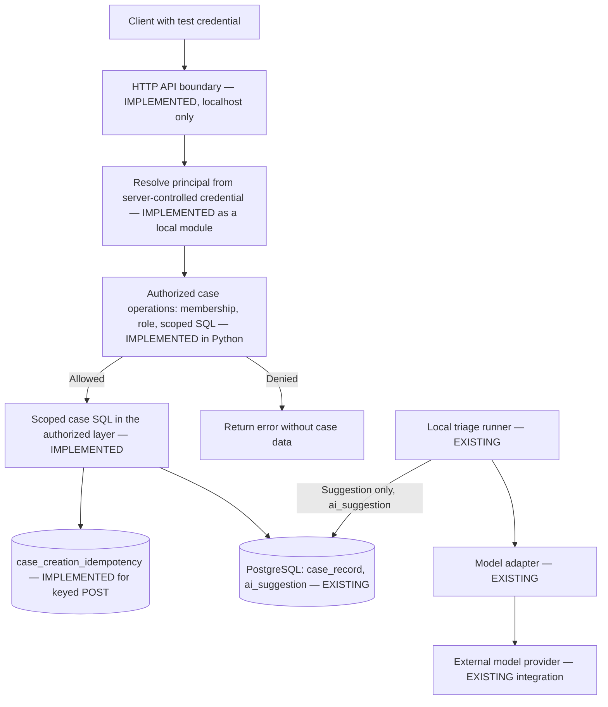

# Service Case API Contract

**Project:** Enterprise AI Service Operations & Intelligence Platform  
**Status:** **The three endpoints are implemented as a localhost-only API** ([`src/api/`](../src/api/); [HTTP results](../tests/http-case-api-results.md)), on top of the Python authorization layer ([`src/authorized_case_operations.py`](../src/authorized_case_operations.py); [results](../tests/case-authorization-results.md)). **Keyed idempotent creation (ADR-0004) is implemented** ([results](../tests/keyed-case-creation-results.md)). **Cursor pagination is not implemented**; its interim behavior is in [section 3.1](#31-implemented-interim-behavior). Not for shared or production deployment.  
**Scope:** `POST /cases`, `GET /cases/{id}`, and `GET /cases`; secure request identity; organization-scoped access; case-creation retry semantics.  
**Evidence class:** Contract plus implemented behavior. Executed HTTP results are in the [HTTP case API results](../tests/http-case-api-results.md) and the [keyed case creation results](../tests/keyed-case-creation-results.md); examples below are illustrative.

## 1. Governing Architecture Decisions

This contract must conform to the following [Architecture Decision Records](adr/README.md). Each row states what the decision requires of the API.

| ADR | Status | Implication for the API contract |
|---|---|---|
| [ADR-0001: PostgreSQL as the Authoritative Case Store](adr/0001-postgresql-authoritative-case-store.md) | Accepted | Case creation and retrieval operate against PostgreSQL as the authoritative store. API responses report the case state recorded there. |
| [ADR-0002: AI Suggestions Are Non-Authoritative](adr/0002-ai-suggestions-non-authoritative.md) | Accepted | `POST /cases` creates a case without requiring AI inference. AI output cannot authorize a request or change case state. |
| [ADR-0003: Application-Controlled Case State Transitions](adr/0003-application-controlled-case-transitions.md) | Accepted | The existing `transition_case()` function must not be exposed through an HTTP endpoint until authentication, tenant authorization, and approval checks exist. The service currently performs none of these checks. |
| [ADR-0004: Keyed Idempotent Case Creation](adr/0004-keyed-idempotent-case-creation.md) | **Accepted** (2026-11-15); implemented 2026-11-16 | The retry contract for `POST /cases` ([section 5](#5-post-cases--create-a-case-implemented)) follows the accepted design: keys scoped to the authorized organization and the verified actor, an identity-only `200` replay, `422` for a payload mismatch, and `503` after a bounded wait. Implemented and tested against PostgreSQL ([results](../tests/keyed-case-creation-results.md)); duplicate-safety applies only to retries that reuse the key. |
| [ADR-0005: Server-Verified Identity and Organization-Scoped Case Authorization](adr/0005-server-verified-identity-and-tenant-authorization.md) | **Accepted** (2026-11-15) | Identity, authorization, revocation, and denial outcomes in [section 4](#4-trust-boundary-sequence) follow this decision. Implemented in the Python layer and the local HTTP API, with HTTP-level tenant-isolation results recorded against PostgreSQL. Isolation is application-layer only: no row-level security. |

**Accepted does not mean implemented.** Some accepted requirements are still unmet; for example, ADR-0003 requires authorization and approval checks before status transitions are exposed, and no transition is exposed. See the [system context](system-context.md#4-capability-status) for current capability status.

## 2. Existing baseline and boundaries

The repository implements a local PostgreSQL `case_record` table and the Python functions `create_case`, `get_case`, and `transition_case` in [`src/case_service.py`](../src/case_service.py), alongside a separate AI triage CLI. `case_record` has a UUID primary key, an owning `organization_id`, title, description, status, version, and timestamps.

- The case service scopes queries by a **caller-supplied** organization UUID. It does **not** authenticate or authorize callers.
- `create_case()` creates a new row on each successful call. It is **not idempotent**.

See the [data model](data-model.md), [controlled case operations](case-operations.md), and [case creation semantics](case-creation-semantics.md).

The HTTP layer does not call these functions. Every route calls the authorized-case-operations layer, and the structural check forbids route code from importing `src/case_service.py`.

## 3. API design choices

| Decision | Rule | Reason |
|---|---|---|
| API shape | Resource-oriented JSON over HTTP; no frontend required | Small, reviewable business boundary |
| Case identifier | Database-generated UUID, unchanged over the case lifecycle | Stable row identity, independent of description or model output |
| Actor identity | `Authorization: Bearer <test-token>`, resolved through **server-controlled, test-only** credential configuration | A caller cannot assume another identity by sending an arbitrary user or organization header |
| Tenant selection | The client supplies a target `organization_id` for create and list. It is **not** proof of ownership; the server verifies membership and operation permission | Supports users who belong to several organizations, without trusting tenant IDs as credentials |
| Authorization | Deny by default unless the actor is active, has an applicable organization membership, and has a role that allows the action | Foreign keys and query predicates alone do not prove access rights |
| Case creation | `POST /cases` writes a case at `NEW`, version `1`, without invoking AI | An accepted case survives a separate AI outage ([ADR-0002](adr/0002-ai-suggestions-non-authoritative.md)) |
| Idempotency | Optional `Idempotency-Key` header; authorization first, then keyed creation, atomic per `(authorized organization_id, verified actor_id, 'case:create', key)` | Prevents unintended duplicate cases after ambiguous response failures ([ADR-0004](adr/0004-keyed-idempotent-case-creation.md), implemented) |
| Read single case | `GET /cases/{id}` checks the case's actual owner against the trusted actor's membership | A guessed UUID must not bypass the tenant boundary |
| List cases | `GET /cases?organization_id=<uuid>&limit=...&cursor=...`; authorization is applied before the scoped query | No implicit all-tenant listing |
| Case status changes | Out of scope for this contract; `transition_case` is not exposed as an unprotected endpoint | The transition service has no verified actor or approval ([ADR-0003](adr/0003-application-controlled-case-transitions.md)) |
| AI suggestions and approval | Out of scope; suggestions remain non-authoritative | A model cannot authorize an operation |

### 3.1 Implemented interim behavior

The local API ([`src/api/`](../src/api/)) implements the three endpoints with these rules. Keyed creation follows ADR-0004; the list shape is interim because cursor pagination is not implemented. Executed results: [HTTP case API results](../tests/http-case-api-results.md).

| Topic | Implemented behavior | Relation to this contract |
|---|---|---|
| Runtime | `python -m scripts.run_local_api` binds `127.0.0.1:8000` only. Configuration (`DATABASE_URL`, `EAISO_CREDENTIALS_FILE`) is read once at startup by the trusted factory; startup fails if it is missing or invalid. No documentation, administrative, credential, provisioning, or transition route exists | As designed; local demonstration only |
| Authentication | Exactly one `Authorization: Bearer <token>` header. A missing, duplicated, or malformed header, and every resolver `Unauthenticated` reason, get one identical `401` (`unauthenticated`, `WWW-Authenticate: Bearer`). Identity headers and body fields are never read | As designed |
| `Idempotency-Key` | Absent: unkeyed create. Present: exactly one field instance, parsed as an RFC 9651 Item that must be a String whose decoded value matches `[A-Za-z0-9._~-]{16,128}`; parameters are ignored. Anything else, including duplicate instances or an underscore spelling of the name, gets `400` `invalid_idempotency_key` and is never treated as unkeyed. A valid key gives the ADR-0004 outcomes in section 5. Raw keys and fingerprints are never logged | As designed (ADR-0004). This replaced the earlier interim `501` |
| Unkeyed create | `201`, `Location: /cases/{id}`, the persisted representation at `NEW`, version `1`. Separate identical requests create separate cases | As designed |
| List shape | `{"items": [...], "has_more": true/false}`, ordered by `(created_at, id)`, without descriptions; `limit` 1–100, default 20 | **Interim:** no `next_cursor` field, because cursors are not implemented. A `cursor` parameter gets `400` `cursor_not_supported`; it is never silently ignored |
| Request syntax | Unknown or duplicate query parameters: `400`. Missing `organization_id`: `400`. Non-integer `limit`: `400`. Non-JSON content type: `415`. Body over 64 KiB: `413`. Malformed JSON or duplicate JSON keys: `400`. Missing, extra, or non-string body fields: `422` | Settles the `400`/`422` split: parameter syntax `400`, body fields `422` |
| Value checks | Canonical-UUID form, blank or over-long text, invalid characters, and the `limit` range are checked by the layer **after** authentication: `400` for path and query values, `422` for body fields | See ordering below |
| Ordering | (1) `Idempotency-Key` syntax; (2) `Authorization` header syntax; (3) request syntax and body schema; (4) credential verification in the layer; (5) value checks; (6) authorization; (7) for a keyed request only, the key reservation or lookup. A malformed body with a well-formed but invalid credential therefore gets `400`/`415`/`422`, not `401` | Documented and tested; authorization always precedes key lookup |
| Server errors | `CaseOperationUnavailable` and `AuthenticationUnavailable`: one generic `500` (`internal_error`). `CaseCreationOutcomeUnknown`: `500` `case_creation_outcome_unknown`, which neither claims success nor rollback; for a keyed request it says to retry with the same key and payload, and for an unkeyed request it warns that a retry may create a duplicate. A keyed request whose competing same-scope request stays unresolved past the bounded wait: `503` `idempotency_request_in_flight`. Server errors carry a server-generated `request_id`; every response has `X-Request-ID`. Client-supplied request IDs are ignored | As designed |

**The bearer token is a local demonstration mechanism.** It is not production OIDC, JWT validation, SSO, or a completed login implementation. The server must resolve each opaque token to a principal through internal fixtures or configuration that clients cannot edit. An arbitrary `X-User-Id`, `X-Actor-Id`, or `X-Org-Id` header, or a decoded but unverified token, is never proof of identity. Working tokens and other secrets must not be committed.

## 4. Trust-boundary sequence



**Request authority flows** from an authenticated actor, to a verified membership, to a permitted operation, to scoped database access. It never flows from a model response or an untrusted organization identifier. Keyed creation writes its idempotency record in the same transaction as the case, after authorization. The existing local triage runner, not the model adapter, persists non-authoritative suggestions, and it remains separate from HTTP case creation. The detailed request sequence, with per-endpoint decision flows and implementation notes, is in [Server-side authentication and authorization sequence](authentication-authorization-sequence.md).

### Authorization rule (accepted in ADR-0005)

Given a **verified** `actor_id`, an action (`case:create`, `case:read`, or `case:list`), and an organization:

1. Verify that the actor is active and allowed to use the application.
2. Obtain the actor's active membership and role in that organization from **server-owned data**, not from request claims.
3. Check that the role grants the action. The initial demonstration matrix is deliberately narrow:
   - `service_engineer` and `service_manager` can create, read, and list cases in their own member organizations.
   - `requester` may create cases only in its own member organization (accepted in ADR-0005; implemented in the Python layer). It gets no case reading or listing until per-case requester ownership and permissions are modeled. See the [minimum role-permission policy](authorization-permissions.md).
   - `platform_administrator` is **not** automatically entitled to all customer data without an explicit decision.
4. When fetching by case ID, determine the case's actual `organization_id` and check membership. Never accept a claimed owner without verification.
5. Restrict every SQL read to the authorized scope, for example `WHERE c.id = :case_id AND c.organization_id = :authorized_org_id`. This predicate is defense in depth **after** membership is verified, not a replacement for it.
6. Do not expose cases or their existence outside the actor's scope. For a single case, return a generic `404` for both nonexistent and inaccessible IDs. For an explicitly requested forbidden organization listing, return `403` without rows. Both outcomes must be tested.

`organization` and `case_record` are implemented. The normalized `actor` and `organization_membership` tables are implemented ([`db/003_actor_identity_and_grants.sql`](../db/003_actor_identity_and_grants.sql)). The role matrix and the enforcement architecture are **accepted** in [ADR-0005](adr/0005-server-verified-identity-and-tenant-authorization.md) and implemented in the Python authorized-case-operations layer, which the local HTTP API calls. The roles come from the [requirements](requirements.md#3-users-and-responsibilities); the exact permission rules are specified in ADR-0005 and the [minimum role-permission policy](authorization-permissions.md).

## 5. `POST /cases` — create a case (IMPLEMENTED)

**Authorization:** a trusted actor with `case:create` in the intended organization.  
**Headers:** `Authorization: Bearer <test-token>`; `Content-Type: application/json`; optional `Idempotency-Key: "<client-generated-key>"` (an RFC 9651 String, so quoted on the wire).

**Example request (synthetic UUIDs):**

```http
POST /cases HTTP/1.1
Authorization: Bearer <test-token>
Idempotency-Key: "synthetic-case-create-001"
Content-Type: application/json

{
  "organization_id": "11111111-1111-4111-8111-111111111111",
  "title": "VPN access unavailable",
  "description": "Several fictional users cannot connect to the company VPN."
}
```

`organization_id` selects the intended target; it is not proof of membership. Unknown or unauthorized target organizations are rejected before persistence. The client cannot set `id`, `status`, `version`, `created_at`, `updated_at`, `model_id`, or `actor_id` through this request. Unexpected body fields are rejected as invalid rather than silently ignored, so privileged fields cannot slip through.

**New-case response:** `201 Created`, with `Location: /cases/<id>` and the persisted case representation. The response is returned only after the transaction commits; this is not a `202 Accepted` asynchronous operation. The `Location` header identifies the new resource, as described in [RFC 9110](https://www.rfc-editor.org/rfc/rfc9110.html).

```http
HTTP/1.1 201 Created
Location: /cases/22222222-2222-4222-8222-222222222222
Content-Type: application/json

{
  "id": "22222222-2222-4222-8222-222222222222",
  "organization_id": "11111111-1111-4111-8111-111111111111",
  "title": "VPN access unavailable",
  "description": "Several fictional users cannot connect to the company VPN.",
  "status": "NEW",
  "version": 1,
  "created_at": "2026-11-16T09:00:00Z",
  "updated_at": "2026-11-16T09:00:00Z"
}
```

### Retry contract (ADR-0004; implemented)

The rules below are the accepted architecture ([ADR-0004](adr/0004-keyed-idempotent-case-creation.md)), implemented in the authorized case operations and the local HTTP API and tested against PostgreSQL ([results](../tests/keyed-case-creation-results.md)). The transaction reserves the key before inserting the case ([Case creation semantics, implemented transaction](case-creation-semantics.md#implemented-transaction)). Requests without a key, and the local `create_case()` service, remain non-idempotent.

- **Authorization first.** Every keyed request, including a replay, is authenticated and authorized for `case:create` **before** any key lookup. A denied or revoked actor gets `401` or `403` and cannot retrieve any stored idempotency result.
- **Scope.** `(authorized organization_id, verified actor_id, 'case:create', exact idempotency_key)`. The same key used by another actor in the same organization, or by the same actor in another organization, is an independent operation.
- **Header syntax.**
  - `Idempotency-Key` is an [RFC 9651](https://www.rfc-editor.org/rfc/rfc9651#section-3.3.3) Item whose value must be a String, per the IETF draft. It is sent quoted, as in `Idempotency-Key: "synthetic-case-create-001"`.
  - The **decoded** value must match case-sensitive `[A-Za-z0-9._~-]{16,128}`.
  - Parameters are ignored.
  - A parse failure, a non-String item (for example, an unquoted value), or a pattern mismatch gets `400`. The field is never silently ignored.
  - Clients should use high-entropy values such as UUIDv4. Raw keys are never logged.
- **Replay.** The same scope with an equal request fingerprint inserts nothing and returns `200 OK` with identity only (see below).
- **Payload mismatch.** The same scope with a different fingerprint gets `422 Unprocessable Content` with error code `idempotency_payload_mismatch`. There is no new case, no mutation, and no detail of the earlier request. The fingerprint is defined in [Case creation semantics, rule 10](case-creation-semantics.md#3-design-decision-distinct-creation-by-default-idempotent-creation-by-key): RFC 8785 and SHA-256, with duplicate and unknown properties rejected.
- **Concurrency.** Concurrent requests in the same scope produce at most one case. A database uniqueness constraint within the creating transaction enforces this, not a `SELECT` followed by an unprotected `INSERT`.
  - A waiting request waits for a bounded, configurable time.
  - If the outcome is still unresolved, it gets `503 Service Unavailable` (`idempotency_request_in_flight`); no `Retry-After` is sent. The default wait is 2000 ms (`EAISO_IDEMPOTENCY_WAIT_MS`).
  - A timeout proves neither success nor failure; retry with the same key.
- **Rollback.** If the first transaction rolls back, a retry may create the case once.
- **No key.** Separate successful requests without a key, including requests with identical text, create distinct cases.

**Replay response.** This differs from the `201` creation response by design:

```http
HTTP/1.1 200 OK
Location: /cases/22222222-2222-4222-8222-222222222222
Idempotency-Replayed: true
Content-Type: application/json

{
  "id": "22222222-2222-4222-8222-222222222222",
  "organization_id": "11111111-1111-4111-8111-111111111111"
}
```

The replay body carries only immutable creation identity, taken from the idempotency record. It never includes the case's current `status`, text, or `version`, so a create-only requester gains no `case:read` ability through replays.

**Payload-mismatch response** (illustrative):

```http
HTTP/1.1 422 Unprocessable Content
Content-Type: application/json

{
  "error": {
    "code": "idempotency_payload_mismatch",
    "message": "Idempotency key was already used with a different request"
  }
}
```

**Settled in implementation:** a 2000 ms default bounded wait, from measurement, and no `Retry-After`. **Separate decisions:** production retention, and whether keys become mandatory for some clients. See [Case creation semantics, section 4](case-creation-semantics.md#4-remaining-implementation-decisions). A lost response after an ambiguous failure is resolved by retrying with the same key and payload: a replay if the case committed, a single create if it did not.

## 6. `GET /cases/{id}` — fetch one case (IMPLEMENTED)

**Headers:** `Authorization: Bearer <test-token>`.

```http
GET /cases/22222222-2222-4222-8222-222222222222 HTTP/1.1
Authorization: Bearer <test-token>
```

**Success:** `200 OK` with the current authorized case representation (the same fields as above). The API checks the case's real owner and the principal's membership and permission. If the case does not exist **or is outside the permitted scope**, it returns a nondisclosing `404 Not Found` and does not reveal another tenant's title, status, or owner.

`version` is the database revision number. It supports later conditional writes and stale-update detection. **This contract introduces no update endpoint and no HTTP conditional-write behavior.**

## 7. `GET /cases` — list within one organization (IMPLEMENTED, without cursors)

**Query:** `organization_id=<uuid>` is required; `limit` defaults to 20, with a maximum of 100; `cursor` is optional and opaque (**not implemented**: a `cursor` currently gets `400`, and the response carries `has_more` instead of `next_cursor`; see [section 3.1](#31-implemented-interim-behavior)). The server verifies that the actor can list cases in that organization and applies `organization_id` filtering in the SQL query. The cursor is scoped to the authorized organization and must never work as a capability to switch tenants.

**Ordering:** `(created_at ASC, id ASC)`, for a stable, deterministic keyset order. A future cursor may encode the last tuple; the exact cursor representation is not yet decided. An empty result is `200 OK` with an empty `items` list. No data across all organizations is returned when `organization_id` is absent or invalid.

```http
GET /cases?organization_id=11111111-1111-4111-8111-111111111111&limit=20 HTTP/1.1
Authorization: Bearer <test-token>
```

```json
{
  "items": [
    {
      "id": "22222222-2222-4222-8222-222222222222",
      "organization_id": "11111111-1111-4111-8111-111111111111",
      "title": "VPN access unavailable",
      "status": "NEW",
      "version": 1,
      "created_at": "2026-11-16T09:00:00Z"
    }
  ],
  "next_cursor": null
}
```

This example shows the target cursor contract. The implemented interim response carries `"has_more": true` or `false` in place of `next_cursor` ([section 3.1](#31-implemented-interim-behavior)).

The list representation omits the full description to avoid unnecessary disclosure, and it is still subject to full access checks. Case-specific requester access is not yet modeled, so blanket listing is not granted to every requester.

## 8. Error contract

All error responses use a consistent envelope, for example:

```json
{
  "error": {
    "code": "case_not_found",
    "message": "Case not found"
  }
}
```

| HTTP status | Situation | Disclosure rule |
|---|---|---|
| `400 Bad Request` | Malformed JSON; an `Idempotency-Key` that fails RFC 9651 String parsing, is not a String, or fails the key pattern; invalid parameter syntax | No internal details; the raw key is not echoed or logged |
| `401 Unauthorized` | Missing, expired, invalid, unknown, or revoked credential, or a credential that maps to no existing actor | No other user or organization header is trusted as a fallback |
| `403 Forbidden` | A valid credential for an **inactive** actor; or a valid actor explicitly requests an organization (create or list) where it lacks the required membership or permission, including a nonexistent organization | No case records returned |
| `404 Not Found` | A single-case lookup is missing or outside the actor's authorized scope | Does not disclose whether a foreign case exists |
| `409 Conflict` | Reserved for a **future** stale-write conflict. It is not used for idempotency. | No unintended database mutation |
| `422 Unprocessable Content` | Well-formed JSON with missing, blank, or invalid business fields, or disallowed attributes. Separately, error code `idempotency_payload_mismatch` when the same actor reuses an idempotency key in the same organization with a different request fingerprint (see [section 5](#5-post-cases--create-a-case-implemented)). | Field-level messages may be returned for validation errors, without personal data. A payload mismatch returns no detail of the earlier request. |
| `415 Unsupported Media Type` (implemented) | `POST /cases` without `Content-Type: application/json` | No body echo |
| `413 Content Too Large` (implemented) | Request body over 64 KiB | No body echo |
| `500 Internal Server Error` | Unexpected internal failure; database or credential-store failure; or (code `case_creation_outcome_unknown`) a create whose commit outcome is unknown | Safe, generic response with a correlation ID; no SQL or secrets exposed; an unknown outcome is never reported as success or rollback |
| `503 Service Unavailable` | A keyed create whose outcome cannot be established within the bounded wait (default 2000 ms), while a concurrent request with the same scope is in flight (code `idempotency_request_in_flight`; implemented) | Claims neither success nor rollback; no case data; this request created nothing; safe to retry with the same key |

A server-generated correlation or request ID is used in logs and may be returned in a response header. It is **observability identity**, not the case ID or the idempotency key. A client-supplied request ID never grants authority.

## 9. Normalization and data shape

**Implemented, normalized foundation:**

- `organization(id, name, slug, ...)` stores each organization once, rather than copying its name into every case.
- `case_record(id, organization_id FK, title, description, status, version, timestamps)` stores authoritative current case state and its owning organization.
- `ai_suggestion(case_id FK, case_version, ...)` keeps zero or more non-authoritative model outputs out of the mutable case row.
- `case_status_event(case_id FK, from_status, to_status, from_version, to_version, ...)` records transition history separately from the current case row.

**Identity normalization (implemented in migration 003):** see the [actor and organization membership model](identity-model.md) for the detailed design.

- `actor(id, ...)` represents a server-verified application principal, or an internal mapping to an identity system.
- `organization_membership(actor_id FK, organization_id FK, role, active, ...)` associates an actor with an organization, instead of a single `actor.organization_id` or a comma-delimited list. For a single role per membership, uniqueness is enforced on `(actor_id, organization_id)`. Multiple role assignments would need a deliberately different key or schema.
- `case_creation_idempotency(organization_id, actor_id, operation, idempotency_key, fingerprint_version, request_fingerprint, case_id, created_at)` is implemented in [`db/004_case_creation_idempotency.sql`](../db/004_case_creation_idempotency.sql) ([ADR-0004](adr/0004-keyed-idempotent-case-creation.md)). The scope is the primary key, and a deferred composite foreign key ensures the record can only reference a case owned by the same organization. It identifies a repeated *request*, not a repeated *incident description*; records never expire in the local demonstration.

**Functional dependency and anomaly example.** If an actor belongs to several organizations, a single `organization_id` on the actor row loses legitimate memberships. A comma-separated list makes it hard to enforce foreign keys and to revoke one membership safely. A membership relation captures the many-to-many association and the role that applies in each organization. Organization names and actor roles are not duplicated into `case_record` rows, because those values change independently of the case.

**Tradeoff.** Joins to `organization_membership` add query work, but they keep access rules at the right grain. Query plans should be measured against a fixed dataset before optimization indexes are chosen; nothing is denormalized for unmeasured speed.

## 10. Critical query shapes to measure next

The queries below are **design candidates**, not benchmark results.

```sql
-- Single-case lookup after actor scope is resolved and authorized:
SELECT id, organization_id, title, description, status, version,
       created_at, updated_at
FROM case_record
WHERE id = $1 AND organization_id = $2;

-- Scoped list, using deterministic order and a future keyset cursor:
SELECT id, organization_id, title, status, version, created_at
FROM case_record
WHERE organization_id = $1
ORDER BY created_at ASC, id ASC
LIMIT $2;
```

No `case_record(organization_id, created_at, id)` index is added yet. The next measurement increment records `EXPLAIN (ANALYZE, BUFFERS)` plans using the **existing** primary-key and unique indexes. A later increment compares index changes using a controlled data generator and representative workloads.

## 11. Acceptance tests and proof boundaries

The statuses below refer to **HTTP** tests through the local API against PostgreSQL ([HTTP case API results](../tests/http-case-api-results.md)). Python-layer equivalents are recorded separately ([case authorization results](../tests/case-authorization-results.md)). Keyed-creation rows are from the [keyed case creation results](../tests/keyed-case-creation-results.md).

| Scenario | Intended outcome | Status |
|---|---|---|
| No credential | `401`; no case access | PASSED (HTTP) |
| Org A service engineer creates an Org A case | `201`; new persistent UUID at `NEW`, version `1` | PASSED (HTTP) |
| Org B actor tries to create a case for Org A | `403`; no insert | PASSED (HTTP) |
| Org B actor requests an Org A case by ID | Nondisclosing `404`; no case data | PASSED (HTTP) |
| Org B actor lists Org A cases | `403`; no case rows | PASSED (HTTP) |
| Forged `X-Org-Id` or `X-User-Id` | Cannot change the resolved principal, memberships, or scope | PASSED (HTTP) |
| Same actor, organization, key, and payload submitted twice | One case; `201`, then a `200` replay with identity only | PASSED (HTTP) |
| Same actor, organization, and key with a changed payload | `422` `idempotency_payload_mismatch`; no second case | PASSED (HTTP) |
| Unquoted, non-String, or out-of-pattern `Idempotency-Key` | `400`; no case; not treated as an unkeyed request | PASSED (HTTP) |
| Two concurrent creates in the same scope | At most one case; the later request replays, conflicts, or gets `503` | PASSED (HTTP, real concurrent sessions) |
| Two actors in one organization use the same key, with the same and with a changed payload | Independent operations; two cases; no replay, no conflict | PASSED (HTTP) |
| Requester replays after the case was changed | Replay body contains only `id` and `organization_id`; no current state | PASSED (HTTP) |
| Replay after the membership was revoked | Denied before key lookup; nothing revealed about the key | PASSED (HTTP; no key query observed) |
| Same key value used in two organizations | Independent requests; one case for each organization | PASSED (HTTP) |
| Simulated failure after the case insert in a keyed create | Neither the case nor the idempotency record persists | PASSED (HTTP; simulated and real faults) |
| Identical-content requests without a key | Two distinct cases | PASSED (HTTP) |
| Case read and list query plans captured before new indexes | Actual plans, row counts, and PostgreSQL version recorded | NOT MEASURED |

Database-mutating tests use the dedicated `eaiso_test` database. The existing case-service test `test_wrong_organization_scope_cannot_read_or_update` ([results](../tests/case-operations-results.md)) demonstrates query scoping by a caller-supplied organization ID. It is **not** proof of HTTP-level tenant authorization. HTTP tests must authenticate a verified demonstration actor, make the HTTP request, and check both the response and the persisted state. Additional negative tests should cover absent or disabled memberships, role mismatches, and unknown case IDs.

## 12. Next implementation increments

Done: server-controlled identities and memberships; the authorized Python layer; authenticated `GET /cases/{id}`, scoped `GET /cases`, and unkeyed and keyed idempotent `POST /cases` (ADR-0004) over local HTTP; HTTP integration, concurrency, and lost-commit tests against `eaiso_test`.

Next, each as its own increment:

1. Cursor pagination for `GET /cases`, replacing the interim `has_more` shape.
2. Query-plan captures before any new index.
3. Finite idempotency-record retention, expiry semantics, and cleanup, before any use beyond the local demonstration.
4. Verified-actor attribution on cases and events, and any HTTP status transition, only with the approval checks ADR-0003 requires.

## 13. References

- [Requirements](requirements.md)
- [Architecture Decision Records](adr/README.md)
- [Architecture context](architecture-context.md)
- [System context](system-context.md)
- [Data model](data-model.md)
- [Controlled case operations](case-operations.md)
- [Case creation semantics](case-creation-semantics.md)
- [RFC 9110: HTTP Semantics](https://www.rfc-editor.org/rfc/rfc9110.html)
- [PostgreSQL 16: Constraints](https://www.postgresql.org/docs/16/ddl-constraints.html)
