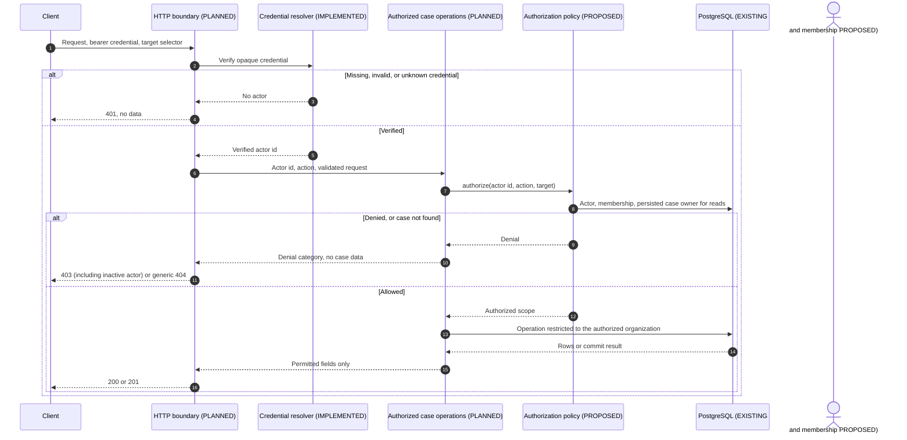

# Server-Side Authentication and Authorization Sequence

**Project:** Enterprise AI Service Operations & Intelligence Platform  
**Status:** **Partly implemented.** The architecture is **accepted** in [ADR-0005](adr/0005-server-verified-identity-and-tenant-authorization.md) (2026-11-15). Implemented: the `actor` and `organization_membership` tables ([`db/003_actor_identity_and_grants.sql`](../db/003_actor_identity_and_grants.sql)) and the local credential resolver ([`src/credential_auth.py`](../src/credential_auth.py); [section 5.1](#51-implemented-local-credential-resolver)). **Not implemented:** an HTTP API, the authorization policy, the authorized-case-operations layer, request logging, and any HTTP tenant-isolation test.  
**Scope:** The request-time sequence for `POST /cases`, `GET /cases/{id}`, and `GET /cases`. It describes **how** the [minimum role-permission policy](authorization-permissions.md) is to be enforced, as accepted in ADR-0005. It does not implement anything.  
**Evidence class:** Architecture design, except section 5.1, which describes implemented code with recorded test results ([credential verification results](../tests/credential-verification-results.md)). The other diagrams, pseudocode, and test cases are proposals, not observed results.

## 1. Baseline

**What exists:**

- `organization`, `case_record`, and `ai_suggestion` are created by [`db/001_init.sql`](../db/001_init.sql); `case_status_event` by [`db/002_case_status_events.sql`](../db/002_case_status_events.sql).
- [`src/case_service.py`](../src/case_service.py) filters queries by a **caller-supplied** `organization_id`. That is query scoping, not authorization.
- The passing test `test_wrong_organization_scope_cannot_read_or_update` ([results](../tests/case-operations-results.md)) shows only that filtering. It is not evidence of authenticated tenant isolation.
- `actor` and `organization_membership` exist, with role-grant eligibility guards ([`db/003_actor_identity_and_grants.sql`](../db/003_actor_identity_and_grants.sql)).
- A local credential resolver ([`src/credential_auth.py`](../src/credential_auth.py)) verifies opaque test credentials and returns an `actor.id`, or a typed failure. Nothing calls it yet.
- No row-level security is enabled. A foreign key proves that a referenced organization exists. It never proves that a caller is a member of it.

**Design inputs:**

- The [API contract](api-contract.md): endpoints and error outcomes.
- The [identity model](identity-model.md): `actor`, and `organization_membership` keyed by `(actor_id, organization_id)`, both implemented as schema.
- The [permission policy](authorization-permissions.md): permissions, matrix, predicates, and test vectors V01–V22.

**Governing decisions:**

- [ADR-0001](adr/0001-postgresql-authoritative-case-store.md): PostgreSQL is authoritative but provides no tenant authorization by itself.
- [ADR-0002](adr/0002-ai-suggestions-non-authoritative.md): AI output and case text never confer permissions.
- [ADR-0003](adr/0003-application-controlled-case-transitions.md): `transition_case()` must not be exposed to untrusted callers.
- [ADR-0004](adr/0004-keyed-idempotent-case-creation.md): **Accepted** (2026-11-15) as design, **not implemented**. Its key scope is the *authorized* organization plus the *verified* actor.
- [ADR-0005](adr/0005-server-verified-identity-and-tenant-authorization.md): **Accepted** (2026-11-15) as architecture, **not implemented**. It records this sequence's identity, enforcement, and revocation decisions.

**Policy summary.** All rows below assume an active actor with an active membership in the organization being evaluated. Any other state is denied.

| Role | Create | Read | List |
|---|---|---|---|
| `service_engineer` | Allow | Allow | Allow |
| `service_manager` | Allow | Allow | Allow |
| `requester` | Allow, create-only in its own member organization (accepted in ADR-0005) | Deny | Deny |

`platform_administrator` has no implicit access. Unknown roles have no permissions.

## 2. Separate concerns

| Concern | Input | Output | Trusts client-supplied IDs? |
|---|---|---|---|
| **Authentication** | `Authorization: Bearer <opaque test credential>` | A verified `actor.id`, or rejection | No |
| **Principal status** | Verified `actor.id` | `actor.is_active` confirmed | No |
| **Authorization** | Verified actor, action, target organization | Allow, as a server-created scope, or deny | The target organization is a **selector** only |
| **Enforcement** | The server-created scope and a validated request | A case operation restricted to the authorized organization | No |

The client may **request** a target organization. It cannot tell the server who it is, which organizations it belongs to, what role it holds, or who owns a case.

## 3. Component responsibilities

These components are logical; only the credential resolver and the PostgreSQL tables exist so far. They can be modules in one small Python application; they do not need to be separate services.

| Component | Responsibility | Must not |
|---|---|---|
| **HTTP boundary** (PLANNED) | Parse and validate the route, headers, and body shape. Call the credential resolver. Map outcomes to HTTP responses. | Infer identity or permission from URLs, headers, or body fields. Call `src/case_service.py`, or issue SQL against case tables, directly. |
| **Credential resolver** (IMPLEMENTED: [`src/credential_auth.py`](../src/credential_auth.py)) | Verify an opaque, local, test-only credential against server-controlled configuration and return an `actor.id`. | Accept a display name, client-supplied actor ID, unverified token claims, or tenant headers as identity. |
| **Authorization policy** (PROPOSED) | Load the actor, the membership, and the persisted case owner (for reads). Evaluate the exact permission. Return either an authorized scope or a denial. | Allow unknown actions or unknown roles, or provide an administrator bypass. |
| **Authorized case operations**, the enforcement layer (PLANNED wrapper around the EXISTING case service) | Be the **only** path from routes to case data. Call the policy itself. Run the operation restricted to the authorized organization. Return only the permitted fields. | Accept a raw organization or actor ID from the route as authority. |
| **PostgreSQL** (EXISTING, including actor and membership tables) | Authoritative case data, and later actors and memberships. | Be treated as an authorization mechanism because foreign keys exist. |
| **Request logging** (PLANNED) | Record a correlation ID, the action, the verified actor reference, the decision, and a sanitized error category. | Log credentials or case text, or record client headers as verified identity. |

**Which component enforces the decision?** The authorized-case-operations layer. A route hands that layer a verified actor and a validated request, and the layer **calls the policy itself**. A route therefore cannot perform a case operation while skipping the decision.

Python cannot make the lower-level functions unreachable. The rule that routes never import `src/case_service.py` directly is therefore backed by code review and an automated structural check (accepted in ADR-0005; the check's mechanism is chosen during implementation). The authorized scope is a value created by the server, not a cryptographic capability.

## 4. Logical sequence



The diagram shows **logical order**. It does not claim that a separate policy query followed by a separate operation is free of races (section 8). For reads and lists, the policy check and the operation may be merged into one scoped query. A database failure at any step gives a generic `500` and no protected operation (section 7).

## 5. From credential to actor

**How the API determines a trusted `actor.id`:**

1. A **local, test-only, opaque** bearer credential is generated independently of `actor.id`.
2. The server maps that credential to an `actor.id` using configuration the client cannot read or edit. No usable credential value is committed to the repository.
3. An unknown credential is rejected with `401`. There is **no fallback** to `X-Actor-Id`, `X-User-Id`, `X-Org-Id`, query parameters, body fields, or `display_name`.

**Why knowing an actor UUID or display name is not enough:**

- A UUID is an identifier, not a secret. It can appear in responses, logs, or URLs, and being hard to guess is not authentication.
- `display_name` is not unique, not secret, and not bound to any credential ([identity model §3](identity-model.md#3-actor)).
- Only possession of a credential that the server verifies yields an actor ID. Even then, the actor ID alone authorizes nothing: the active actor, the membership, the role, and the target must all still be checked.

**What this is not:** production authentication, OIDC, JWT signature verification, SSO, or session management. Until real authentication is designed, the demonstration API must stay local or test-only. Credential and lookup-key values must never be logged.

**Accepted in ADR-0005:**

- Credentials are generated with a cryptographically secure random generator.
- Revocation removes or disables the credential mapping. Rotation replaces the credential and keeps the same `actor.id`.
- A missing, invalid, unknown, or revoked credential gets `401`. So does a credential that maps to an actor ID with no `actor` row.
- A valid credential for an inactive actor gets `403`.

**Left to implementation:** the configuration mechanism and the comparison method, for example a hashed lookup or a constant-time comparison. Section 5.1 records the choice.

### 5.1 Implemented local credential resolver

[`src/credential_auth.py`](../src/credential_auth.py) implements the resolver; [`scripts/manage_test_credentials.py`](../scripts/manage_test_credentials.py) is the operator tool. Observed results are in the [credential verification results](../tests/credential-verification-results.md). It establishes **identity only**: it does not read memberships, roles, or organizations, and no HTTP route calls it yet.

**Credential format.** `eaiso_test_` followed by `secrets.token_urlsafe(32)`: 256 random bits as 43 base64url characters. The prefix makes test credentials recognizable to secret scanners. Anything that is not exactly this canonical form is rejected as malformed before any lookup.

**Server-controlled configuration.** A local JSON store, by default `.local/test-credentials.json` (git-ignored; override with `EAISO_CREDENTIALS_FILE`). Each entry holds a random `credential_id`, the SHA-256 digest of the credential, the `actor_id`, a status (`active` or `revoked`), and timestamps. **Raw credentials are never stored**: the operator tool prints a new credential once and keeps only its digest. The store is validated strictly (unknown keys, malformed digests or UUIDs, and duplicate digests or IDs are rejected). Writers take an exclusive lock file, so concurrent operator runs cannot lose an update or re-enable a revoked credential, and replace the file atomically, so readers see either the old or the new store.

**Comparison.** The presented credential is hashed with SHA-256 and the digest is looked up in the store. With 256-bit random secrets, an unsalted fast hash is sufficient: the digest cannot be reversed or brute-forced, and lookup timing can reveal at most information about digests, which does not help recover a credential. No secret-dependent string comparison is made on raw values.

**Resolution order and outcomes** (`status_equivalent` is the ADR-0005 status a future HTTP boundary would return; no HTTP response exists):

| Condition | Outcome | `status_equivalent` |
|---|---|---|
| Missing (`None` or empty) | `Unauthenticated("missing")` | 401 |
| Not the canonical format, including actor IDs, display names, digests, or `Bearer …` strings | `Unauthenticated("malformed")` | 401 |
| Well-formed but not in the store | `Unauthenticated("unknown")` | 401 |
| Mapping revoked | `Unauthenticated("revoked")` | 401 |
| Mapping names an actor with no `actor` row | `Unauthenticated("actor_not_found")` | 401 |
| Actor exists but `is_active = FALSE` | `InactiveActor` | 403 |
| Store missing, unreadable, or invalid | `AuthenticationUnavailable("configuration")` | 500 |
| Database unreachable, timed out, or erroring | `AuthenticationUnavailable("database")` | 500 |
| Active mapping, active actor | `VerifiedActor(actor_id, credential_id)` | — |

The actor check is one read-only statement (`SELECT is_active FROM actor WHERE id = …`) with bounded connect and statement time. A later authorization step must still repeat the actor predicate inside its own scoped statement or transaction (section 8).

**Lifecycle.** *Revocation* marks a mapping `revoked`, or removes it. *Rotation* issues a new credential for the same `actor_id` and revokes the old one in a single atomic store write. The store is re-read on every resolution and re-parsed when its content changes, so both take effect on the next call without a restart. If the store later becomes unreadable or invalid, resolution fails closed instead of using the previous mapping.

**Logging.** Records carry only the outcome category, the non-secret `credential_id`, and the verified `actor_id`. Raw credentials and digests never appear in logs or exception messages. Dependency exceptions are not chained into authentication errors (neither `__cause__` nor `__context__`), so a driver message that echoed a secret cannot leak through an error reporter that walks the chain.

**For the future HTTP boundary.** Every `Unauthenticated` reason must produce the **same** `401` response; the `reason` is for server-side logs only, so a client cannot tell an unknown credential from a revoked one.

**Limitations.**

- The store is a local file. Anyone who can write it, or the database, controls which actor a credential names. Owner-only permissions are applied on POSIX only, and the default path is relative to the working directory, so the resolver must be started from the repository root or given `EAISO_CREDENTIALS_FILE`.
- A lock file left by a killed operator run blocks later writes until it is removed by hand. On Windows, a store being replaced while it is read can make one resolution fail closed (`AuthenticationUnavailable`); writers retry a refused replacement briefly.
- There is no expiry, rate limiting, lockout, or audit trail of credential use, and no production credential management, OIDC, or SSO.
- Bearer credentials are replayable by whoever holds them; transport security belongs to the future HTTP boundary.
- Authentication says nothing about authorization: an actor with no grants still authenticates.

## 6. Per-endpoint decision flows

All three flows below are **PLANNED**. They follow accepted ADR-0005, but none is implemented.

### `POST /cases` (`case:create`)

1. Authenticate (`401` on failure).
2. Validate the body. Reject unexpected fields such as `id`, `actor_id`, `role`, `status`, or `version`; they are **not silently ignored** ([API contract §5](api-contract.md#5-post-cases--create-a-case-planned)). The body's `organization_id` is an **untrusted selector**.
3. Check that the actor is active (`403` if not).
4. Look up the membership for `(actor, requested org)`. It must be active, and its role must grant `case:create`. Otherwise return `403` with no case data.

   A nonexistent organization has no membership, so it gets the same `403` as a foreign organization. The response does not reveal whether the organization exists.
5. Create the case using the **authorized** organization from the scope, not the raw body value. It starts at `NEW`, version `1`, with no AI call. Return `201` only after commit.
6. **Keyed creation, when enabled** ([ADR-0004](adr/0004-keyed-idempotent-case-creation.md), Accepted design; disabled until ADR-0004 and ADR-0005 are implemented and tested):
   - Authorize first, before any replay lookup.
   - Scope the key as `(authorized organization_id, verified actor_id, 'case:create', key)`.
   - A replay returns `200` with identity only (`id`, `organization_id`), never the current case state (section 9).

**Isolation:** the selector can only choose one of the actor's own active memberships. Any other organization is denied before anything is persisted.

### `GET /cases/{id}` (`case:read`)

1. Authenticate.
2. Parse `{id}` as a UUID. A malformed value is rejected by validation. The ID is a lookup key, not a permission.
3. Check that the actor is active.
4. The organization to evaluate is the case's **persisted** `case_record.organization_id`. A client-supplied organization never asserts ownership.

   Preferred shape: a single query that joins the case to an active membership for the verified actor with a role granting `case:read`, so that no unscoped row is fetched.
5. If no row comes back, return the **same generic `404` status and body**, whether the case does not exist, belongs to another organization, or the actor lacks `case:read`. That includes a requester asking for a case it just submitted.

   This reduces disclosure of whether a case exists. It does not claim to eliminate timing side channels.
6. Return only the permitted fields.

**Isolation:** ownership comes from the database, never from the request. An actor with membership only in B cannot read A's cases by guessing UUIDs.

### `GET /cases?organization_id=…` (`case:list`)

1. Authenticate.
2. Require a valid `organization_id` selector. If it is missing or invalid, reject the request as invalid; the `400`/`422` split is still unsettled. Never fall back to listing all organizations.
3. Check that the actor is active, and that it has an active membership in the selected organization with a role granting `case:list`. Otherwise return `403` with no rows.
4. Apply the authorized organization predicate to **every** list query, including any cursor continuation. Bound the page size. A cursor is bound to the authorized organization and can never switch tenants.
5. Return only the list projection.

**Isolation:** one authorized organization per request. An actor with mixed roles, for example manager in A and requester in B, can list A but gets `403` for B (vector V12).

**Unsupported operations:** there is no HTTP route for case updates, status transitions, AI approval, actor or membership management, or platform-administrator access. An unknown route never dispatches to `transition_case()`. Its absence is not evidence that update authorization exists.

## 7. Policy interface and failure handling

```text
# Conceptual interface only; not source code
resolve_actor(opaque_credential)                         -> ActorId | AuthenticationFailure
authorize(actor_id, action, target)                      -> AuthorizedScope | Denial(category)
run_authorized(scope: AuthorizedScope, validated_request) -> Result      # the only route-facing case API

authorize:
  action not in {case:create, case:read, case:list}  -> Denial(unsupported)
  actor not active                                    -> Denial(inactive_actor)   # 403
  # a credential mapped to a missing actor row is treated as unresolved -> 401
  org := persisted case owner                         if action = case:read
         validated request organization_id (selector) otherwise
  case:read and case not found                        -> Denial(not_found)        # 404
  membership(actor_id, org) missing or not active     -> Denial(forbidden or not_found)
  action not in PERMISSIONS[membership.role]          -> Denial(forbidden or not_found)  # unknown role => {}
  -> AuthorizedScope(actor_id, org, action)
```

These predicates are the same as [policy §4](authorization-permissions.md#4-policy-predicates). For `case:read`, every denial maps to the generic `404`. For create and list, it maps to `403`.

**Failure outcomes:**

| Situation | Outcome |
|---|---|
| Missing, invalid, unknown, or revoked bearer credential, or one that maps to no existing actor | `401`; no lookup of any client-supplied identity |
| Valid credential, inactive actor | `403`, always denied (ADR-0005) |
| No membership, inactive membership, or role lacks the permission, on create or list | `403`, no rows, no membership details |
| Unknown role value | Denied; treated as having no permissions |
| Unknown, foreign, or unreadable case on `GET /cases/{id}` | Identical generic `404` status and body |
| Database outage or policy-evaluation error | **Fail closed:** no protected operation. Generic `500` with a correlation ID, per the [API contract error table](api-contract.md#8-proposed-error-contract). Never a fabricated `403` or `404`, and never a fallback to unscoped SQL. |

**Logging:** record a correlation ID, the verified actor reference where appropriate, the action, the decision, and a sanitized category. Never log credentials, case descriptions, or untrusted headers as identity. Audit and attribution requirements remain **OPEN** ([policy §8](authorization-permissions.md#8-open-issues)).

## 8. Check/use timing and revocation

**Why it races.** If the membership check and the case operation are separate statements, a revocation can commit between them. The operation then runs on an allow decision that is no longer true.

A single statement does not fully close the gap either. Each PostgreSQL statement reads from a snapshot taken when it starts, so a revocation that commits while the statement runs may not be visible to it. **This design does not promise immediate revocation of in-flight requests.**

| Option | Benefit | Limitation |
|---|---|---|
| **A. Separate policy query, then the case operation** | Simplest code | Classic check/use race. An allow decision can be applied after the revocation has committed. |
| **B. Membership predicate inside the case statement**, for example a joined read or `INSERT … SELECT … WHERE EXISTS (active membership)` | Binds authorization and data to one snapshot. A good fit for reads and lists. | A plain statement does not wait for a revocation still in progress. One that commits after the snapshot does not affect the statement. |
| **C. Short transaction: lock the actor and membership rows `FOR SHARE`, then write, then commit** | A concurrent revocation (`UPDATE … SET is_active = false` or a role change) **waits** until the transaction commits. Under READ COMMITTED, a `FOR SHARE` read that meets a concurrent update waits for it, then re-checks its `WHERE` clause against the updated row, so a revocation that commits first is seen. | Lock contention. Deadlock risk if revokers lock rows in a different order; PostgreSQL detects deadlocks and aborts one transaction. Under REPEATABLE READ, the same conflict raises a serialization error that must be handled. Requests that already hold the lock still finish before the revocation. |

**`FOR SHARE` versus `FOR KEY SHARE`.** In PostgreSQL 16, `FOR SHARE` blocks `UPDATE` and `DELETE` of the locked row. `FOR KEY SHARE` blocks only `DELETE`, and updates that change key columns. Updates to non-key columns such as `is_active` or `role` are **not** blocked by it ([explicit locking](https://www.postgresql.org/docs/16/explicit-locking.html), [transaction isolation](https://www.postgresql.org/docs/16/transaction-iso.html)). `FOR KEY SHARE` must therefore not be used if the goal is to hold off a revocation.

**Read-side limit.** Once a read response has been sent, no revocation can take it back. Revocation can only affect requests that have not yet been authorized or committed.

**Accepted minimum contract ([ADR-0005](adr/0005-server-verified-identity-and-tenant-authorization.md), 2026-11-15).** This is not instant revocation.

- **Reads and lists use option B.** One scoped statement carries the actor and membership predicates. For reads, a preceding actor-status check yields `403` for an inactive actor. A request that began before a revocation committed may complete under its snapshot.
- **Writes use option C, under READ COMMITTED:**
  1. lock the actor row `FOR SHARE`, then the membership row `FOR SHARE`, in **two separate statements**, since one joined locking statement does not guarantee lock order;
  2. hold both locks through the write and the commit.

  A revocation that commits first is seen, and the request is denied. A request that took its locks first may finish while the revocation waits.
- **Keyed creation.** The idempotency lookup and reservation run inside this locked transaction.
- **No caching.** Authorization decisions are not cached across requests.

**Still implementation concerns that need executed tests:**

- lock timeouts and bounded waits;
- deadlock handling (revocations that touch both rows should lock actor, then membership);
- error mapping;
- contention.

The contract's behavior under concurrency is **untested**. Never hold locks across model calls, long-running work, or client I/O.

## 9. Requester create-only and idempotent replay

**A later GET.** A requester's `201 Created` response returns the case as part of the create operation. That is not a `case:read` grant. A later `GET /cases/{id}`, including on the `Location` URL, returns the generic `404` (vector V06). Viewing a case's status is deferred until requester ownership is modeled.

**Replay.** [ADR-0004](adr/0004-keyed-idempotent-case-creation.md) and [ADR-0005](adr/0005-server-verified-identity-and-tenant-authorization.md), both **Accepted** as design, define the following contract. None of it is implemented.

1. **Authorization runs before the replay lookup** on every replay. An actor whose actor record or membership is inactive is denied, and the response says nothing about stored keys.
2. **Identity-only replay.** A replay returns `200 OK` with `Location`, `Idempotency-Replayed: true`, and only `id` and `organization_id`, taken from the idempotency record. It never contains the current status, text, or version, so a create-only actor gains no `case:read` ability and sees no later changes.
3. **The key scope includes the actor.** The scope is `(authorized organization_id, verified actor_id, 'case:create', key)`. Another member who reuses or guesses the same literal key gets an independent operation. That member can neither replay the first actor's case nor cause a `422` `idempotency_payload_mismatch` that reveals the key exists. This closes the cross-actor risk recorded in the previous version of this section.

   The deliberate tradeoff is that two actors who submit one incident are not deduplicated.

**Still pending:** implementation of both ADRs, and executed tests (S08, S09, and the ADR-0004 list). Until then this is an accepted design intention, not a guarantee.

## 10. Future negative test cases

These **complement** the policy's vectors V01–V22 ([policy §6](authorization-permissions.md#6-proposed-test-vectors)) with checks specific to the sequence. Each one is **proposed, not executed**. Each must assert both the HTTP response and the database state in the dedicated test database.

| ID | Scenario | Expected outcome | Status |
|---|---|---|---|
| S01 | Valid credential mapped to an actor ID that does not exist | `401`; no case data; no insert | Proposed, not executed |
| S02 | `POST /cases` naming a nonexistent organization, from an actor active in A | `403`, identical to a foreign organization; no insert | Proposed, not executed |
| S03 | `POST /cases` body containing `actor_id`, `status`, or `version` | Rejected as invalid; no insert | Proposed, not executed |
| S04 | A route attempts to reach case data without going through the authorized-operations layer | The structural check fails the build or review | Proposed, not executed |
| S05 | Database unavailable during the policy lookup | Generic `500`; no protected operation; not `403` or `404` | Proposed, not executed |
| S06 | List cursor issued for A, replayed with `organization_id=B` by an actor in A only | `403` or cursor rejected; no B rows | Proposed, not executed |
| S07 | Membership or actor revoked concurrently with a write, under the accepted write-locking contract | A revocation that commits first leads to denial. An operation holding locks first completes while the revocation waits. Observed ordering recorded. | Proposed, not executed |
| S08 | Requester replays its own create key after the case changed | `200` replay with only `id` and `organization_id`; no current state disclosed | Proposed, not executed |
| S09 | A second requester in the same organization reuses the first requester's key, with the same and with a different payload | Independent operation: a new case for the second requester; no replay of, and no `422` mismatch about, the first requester's case | Proposed, not executed |
| S10 | Logs after a `401`, a `403`, and a `404` | No credential value, no case text, no client header recorded as identity | Proposed, not executed |

## 11. Review questions

1. **How is a trusted `actor.id` determined?** Only from a server-verified opaque credential, mapped through server-controlled configuration. A UUID or display name is neither secret nor bound to a credential (section 5).
2. **How are Org A and Org B kept apart?**
   - **Create:** the selector must match an active membership with `case:create`.
   - **Get by ID:** the persisted owner must match an active membership with `case:read`, otherwise a generic `404`.
   - **List:** the selector must match an active membership with `case:list`, and every query is scoped to that organization (section 6).
3. **What enforces the decision?** The authorized-case-operations layer, which calls the policy itself and is the only path routes use to reach case data. An automated structural check plus code review detects bypasses (section 3).
4. **What happens on failures?** A missing membership gives `403`, or `404` for a read. A disabled actor gets `403`. An unknown role is denied. An invalid token gives `401`. An unknown case gives the generic `404`. A database outage gives a generic `500` and no protected operation (section 7).
5. **Why does check-then-write race, and what can be done?** The decision and the write are separated in time, and statements read snapshots. ADR-0005 accepts a minimum contract (section 8):
   - **Reads and lists** use one scoped statement that contains the actor and membership predicates.
   - **Writes** use a short READ COMMITTED transaction with **separate** `FOR SHARE` locking statements, first the actor and then the membership. The locks are held through the protected write and the commit.
   - **Ordering.** An operation that has already taken its locks may finish before a concurrent revocation commits. A revocation that commits first is seen, and the request is denied.

   Revocation of in-flight requests is **not** instantaneous. None of this is implemented, and the PostgreSQL locking behavior has **not** been exercised or tested.
6. **What does requester create-only mean?** A later GET returns `404`. A replay re-authorizes and returns identity only. Keys scoped to the actor make another member's key an independent operation. This is accepted as design, but not implemented or tested (section 9).

## 12. Resolution in the authorization ADR

[ADR-0005](adr/0005-server-verified-identity-and-tenant-authorization.md) (Accepted 2026-11-15) settles or constrains each of the items below:

- the credential lifecycle and the credential-to-actor mapping;
- the inactive-actor status code;
- enforcement placement, and the structural check that routes cannot bypass it;
- acceptance of requester create-only;
- the revocation strategy and lock order, with executed concurrency tests;
- decision caching;
- compatibility with the replay contract accepted in ADR-0004: actor-scoped keys and an identity-only replay;
- direct database writers, optional row-level security, and a least-privilege database role;
- decision logging and attribution.

Still open after acceptance:

- ~~the credential configuration and comparison mechanism~~: implemented locally (section 5.1);
- the structural-check mechanism;
- row-level security and a least-privilege database role;
- verified audit attribution.

This document itself accepts no ADR.

## 13. Document review checklist

These are documentation-review items. A checked box means the statement was verified by inspecting this document against ADR-0004, ADR-0005, and the permission policy on 2026-11-15. It is **not** evidence that any component is implemented or that any test has run.

- [x] Every component, flow, and test is labeled PLANNED or PROPOSED (not implemented), except PostgreSQL, the case service, and the credential resolver (section 5.1), which exist.
- [x] Every allow path starts from a verified credential and requires an active actor, an active membership, and the action-specific permission.
- [x] Create and list use an untrusted selector; get by ID uses the persisted owner. A client-supplied organization ID can only narrow access.
- [x] The outcomes `401`, `403`, and the identical generic `404` match the [policy](authorization-permissions.md#5-suggested-http-outcomes). An inactive actor gets `403`.
- [x] Requester create-only appears as accepted in ADR-0005 but not implemented, and neither a later GET nor a replay grants read access.
- [x] The check/use options are compared, the lock semantics are cited, and only the accepted minimum revocation contract is stated. Nothing is claimed as tested.
- [x] ADR-0004 and ADR-0005 are cited only as **accepted architectural decisions**. The only executed results cited are the identity and credential test reports; no endpoint, policy, or HTTP test result is claimed.

**References:** [OWASP API Security Top 10 2023 — API1: Broken Object Level Authorization](https://owasp.org/API-Security/editions/2023/en/0xa1-broken-object-level-authorization/), [PostgreSQL 16 explicit locking](https://www.postgresql.org/docs/16/explicit-locking.html), and [PostgreSQL 16 transaction isolation](https://www.postgresql.org/docs/16/transaction-iso.html).
