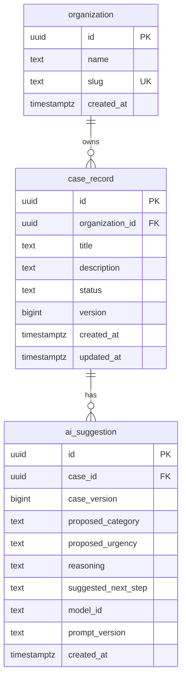
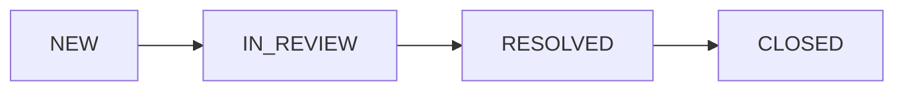

# Initial Relational Data Model

**Project:** Enterprise AI Service Operations & Intelligence Platform  
**Status:** Draft v0.1 — initial PostgreSQL schema implemented; integrity verification in progress.

## 1. Purpose and scope

This document defines the first relational model for service cases and AI-assisted triage. It follows the business requirements in [`requirements.md`](requirements.md) and the ownership decisions in [`architecture-context.md`](architecture-context.md).

The starting model has three entities:

- `organization` — a customer organization whose cases must be kept separate from other customers' cases.
- `case_record` — the authoritative record of a service case, including its current status.
- `ai_suggestion` — a proposed assessment generated for a particular version of a case.

PostgreSQL is the proposed system of record. This document covers the logical structure and intended database constraints. The first migration and its negative tests will be implemented separately.

## 2. Entity relationships

An organization can have zero or many cases; each case belongs to exactly one organization. A case can have zero or many AI suggestions; each suggestion refers to exactly one case. We keep multiple suggestions because a case may be evaluated again after its contents change.

## 3. Entities and attributes

### `organization`

| Attribute | Proposed type | Rule or purpose |
|---|---|---|
| `id` | `uuid` | Primary key; generated by the application or database. |
| `name` | `text` | Required, non-blank display name. |
| `slug` | `text` | Required, unique organization identifier suitable for stable references. |
| `created_at` | `timestamptz` | Required creation timestamp. |

### `case_record`

| Attribute | Proposed type | Rule or purpose |
|---|---|---|
| `id` | `uuid` | Primary key. |
| `organization_id` | `uuid` | Required foreign key to `organization.id`. |
| `title` | `text` | Required, non-blank summary of the issue. |
| `description` | `text` | Required problem description for the initial workflow. |
| `status` | `text` | Required; one of the four case states below. |
| `version` | `bigint` | Required positive revision number, initially `1`. |
| `created_at` | `timestamptz` | Required creation timestamp. |
| `updated_at` | `timestamptz` | Required last-update timestamp. |

`organization_id` identifies the **customer that owns the case**, not the engineer assigned to it. Assignment will be modeled after user identities and assignment rules are defined.

### `ai_suggestion`

| Attribute | Proposed type | Rule or purpose |
|---|---|---|
| `id` | `uuid` | Primary key. |
| `case_id` | `uuid` | Required foreign key to `case_record.id`. |
| `case_version` | `bigint` | Required positive number; the case revision used as model input. |
| `proposed_category` | `text` | AI-proposed issue category. |
| `proposed_urgency` | `text` | AI-proposed urgency. |
| `reasoning` | `text` | Model-provided explanation; not authoritative evidence by itself. |
| `suggested_next_step` | `text` | Proposed next investigation or action. |
| `model_id` | `text` | Identifier of the model used. |
| `prompt_version` | `text` | Identifier of the prompt definition used. |
| `created_at` | `timestamptz` | Required suggestion creation timestamp. |

The application will validate a model response before storing it as a usable suggestion. Values such as `model_id` and `prompt_version` identify its provenance; they do not make its contents trustworthy. The full run evidence and sanitized input/output for the first experiment will be recorded under `evaluations/`.

The exact category and urgency vocabularies are still open; their allowed values should be defined before the relevant schema and model-output validation are finalized.

## 4. Case lifecycle

The initial lifecycle contains four states:

| State | Business meaning |
|---|---|
| `NEW` | A case has been recorded but investigation has not started. |
| `IN_REVIEW` | An engineer is investigating or handling the case. |
| `RESOLVED` | A resolution has been recorded; final closure is still pending. |
| `CLOSED` | The case has been formally closed. |

These arrows define the **initial happy path**, not a complete transition policy. Whether a resolved case can return to review, a closed case can reopen, or particular roles can close a case remains an open business decision.

A database `CHECK` constraint can reject an unknown status, but it does not by itself enforce which status transitions are permitted. Those rules require controlled application operations, authorization checks, and transactional updates.

## 5. Integrity and ownership rules

The first PostgreSQL migration should enforce the rules it can reliably express:

1. **Identity:** Each table has a primary key. `organization.slug` is unique.
2. **Required data:** Required attributes cannot be `NULL`; text inputs that must contain content should also reject blank strings.
3. **Referential integrity:** A case cannot reference an unknown organization; a suggestion cannot reference an unknown case.
4. **Valid state:** `case_record.status` must be one of `NEW`, `IN_REVIEW`, `RESOLVED`, or `CLOSED`.
5. **Revision values:** `case_record.version` and `ai_suggestion.case_version` must be positive integers.
6. **Deletion safety:** Do not cascade-delete cases or suggestions when an organization or case is removed. The initial model should restrict such deletions until retention and deletion policies are decided.

Other guarantees need more than a foreign key or `CHECK` constraint:

- **Tenant authorization:** The application must verify the caller's permitted organization(s) on every protected access path. A valid `organization_id` is not proof of permission. Database row-level security may provide another enforcement layer, but it is not implemented by this model alone.
- **Valid state transitions:** The application must check the current state, the requested transition, and the actor's permission.
- **Concurrent updates:** A future case update should compare the expected `version` and increment it atomically on success; an outdated request should fail rather than silently overwrite newer state.
- **Suggestion freshness:** If a suggestion was generated from case version `3` but the current case is version `4`, it must not be approved for execution without reassessment. Recording `case_version` allows that check but does not perform it automatically.
- **AI authority:** The model must not be given a direct database write path to case state. Suggestions are data for review, not commands.
- **History and approvals:** A current `status` and `updated_at` timestamp do not provide a complete audit trail or approval record. Those capabilities require additional design and tables in later increments.

## 6. Example cases the model must support

**Two separate customers.** Customer A and Customer B each have their own case records. A foreign key ensures ownership references a real organization; authorization rules must prevent either customer from accessing the other's records.

**Repeated triage.** A case receives one suggestion, then its description changes and the case version increases. A second suggestion can be stored without overwriting the first. The earlier suggestion remains identifiable as based on an older case revision.

**Unavailable AI.** A case can be created and its status managed through authorized application operations even if no suggestion exists.

**Model proposes closure.** A suggestion may recommend closing a case, but `case_record.status` does not change until an authorized application operation validates and commits an allowed transition.

## 7. Deferred decisions

- User identities, roles, engineer assignment, and how users are associated with organizations.
- Full transition rules, including reopening and who may resolve or close cases.
- Approval records and case-event history; both are required before claiming a complete reviewed workflow.
- Controlled vocabularies for category and urgency.
- Whether `description` may be absent for imported or partial cases.
- Data retention, deletion, and organization offboarding rules.
- The exact source and format of case revision and model execution evidence.
- Query patterns, indexes beyond keys, tenant-access enforcement, and performance targets; these will be justified by implemented reads and measurements.

**Implementation status:** The initial schema is implemented in [`db/001_init.sql`](../db/001_init.sql), with synthetic development data in [`db/seed_dev.sql`](../db/seed_dev.sql). Database integrity tests are being added separately. The schema provides structural constraints and referential integrity but does **not** yet establish tenant authorization, workflow transition enforcement, or safe concurrent updates.
