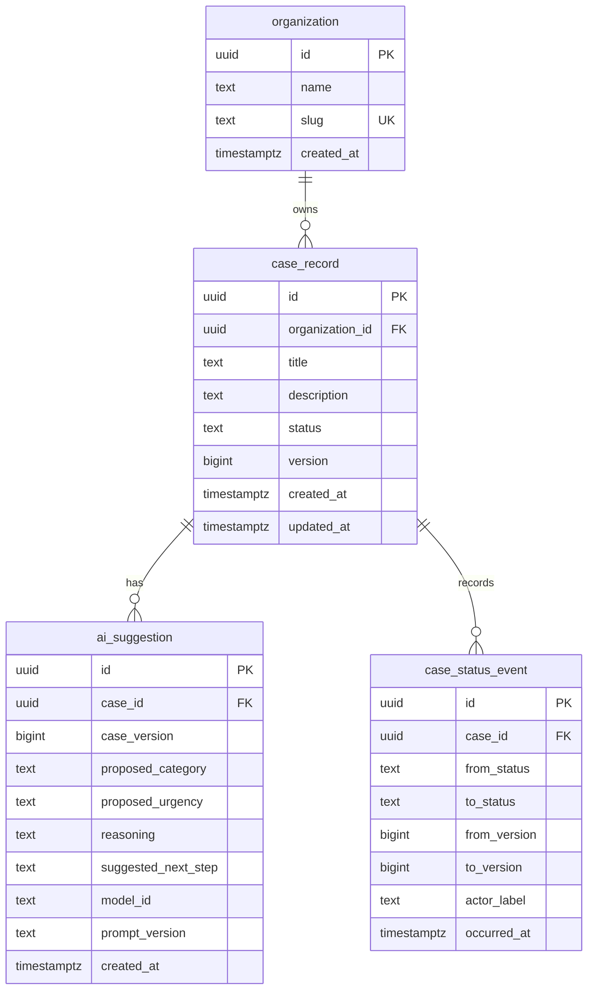
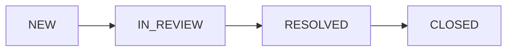

# Initial Relational Data Model

**Project:** Enterprise AI Service Operations & Intelligence Platform  
**Status:** Draft v0.1 — initial PostgreSQL schema implemented; relational integrity validated ([11/11 checks passed](../tests/schema-integrity-results.md)); AI suggestion output contract enforced by the application; case status-transition history added and exercised through a local case service ([16/16 tests passed](../tests/case-operations-results.md)).

## 1. Purpose and scope

This document defines the first relational model for service cases and AI-assisted triage. It follows the business requirements in [`requirements.md`](requirements.md) and the ownership decisions in [`architecture-context.md`](architecture-context.md). The choice of PostgreSQL as the authoritative store is recorded in [ADR-0001](adr/0001-postgresql-authoritative-case-store.md), and service-controlled transitions in [ADR-0003](adr/0003-application-controlled-case-transitions.md). See the [ADR index](adr/README.md) for all decisions.

The model has four entities:

- `organization` — a customer organization whose cases must be kept separate from other customers' cases.
- `case_record` — the authoritative record of a service case, including its current status.
- `ai_suggestion` — a proposed assessment generated for a particular version of a case.
- `case_status_event` — a record of one status transition applied to a case, linking the revision before and after the change.

PostgreSQL is the selected initial system of record. This document covers the logical structure and database constraints. The first three entities are implemented in [`db/001_init.sql`](../db/001_init.sql) and verified by [`tests/test_schema_integrity.sql`](../tests/test_schema_integrity.sql). `case_status_event` is added by [`db/002_case_status_events.sql`](../db/002_case_status_events.sql) and exercised through the local case service by [`tests/test_case_service.py`](../tests/test_case_service.py).

## 2. Entity relationships

An organization can have zero or many cases; each case belongs to exactly one organization. A case can have zero or many AI suggestions; each suggestion refers to exactly one case. We keep multiple suggestions because a case may be evaluated again after its contents change. A case can have zero or many status events, at most one per resulting revision; a newly created case has none.

## 3. Entities and attributes

### `organization`

| Attribute | Proposed type | Rule or purpose |
|---|---|---|
| `id` | `uuid` | Primary key; generated by the application or database. |
| `name` | `text` | Required, non-blank display name. |
| `slug` | `text` | Required, unique organization identifier suitable for stable references. |
| `created_at` | `timestamptz` | Required creation timestamp. |

### `case_record`

| Attribute | Proposed type | Rule or purpose |
|---|---|---|
| `id` | `uuid` | Primary key. |
| `organization_id` | `uuid` | Required foreign key to `organization.id`. |
| `title` | `text` | Required, non-blank summary of the issue. |
| `description` | `text` | Required problem description for the initial workflow. |
| `status` | `text` | Required; one of the four case states below. |
| `version` | `bigint` | Required positive revision number, initially `1`. |
| `created_at` | `timestamptz` | Required creation timestamp. |
| `updated_at` | `timestamptz` | Required last-update timestamp. |

`organization_id` identifies the **customer that owns the case**, not the engineer assigned to it. Assignment will be modeled after user identities and assignment rules are defined.

### `ai_suggestion`

| Attribute | Proposed type | Rule or purpose |
|---|---|---|
| `id` | `uuid` | Primary key. |
| `case_id` | `uuid` | Required foreign key to `case_record.id`. |
| `case_version` | `bigint` | Required positive number; the case revision used as model input. |
| `proposed_category` | `text` | AI-proposed issue category. |
| `proposed_urgency` | `text` | AI-proposed urgency. |
| `reasoning` | `text` | Model-provided explanation; not authoritative evidence by itself. |
| `suggested_next_step` | `text` | Proposed next investigation or action. |
| `model_id` | `text` | Identifier of the model used. |
| `prompt_version` | `text` | Identifier of the prompt definition used. |
| `created_at` | `timestamptz` | Required suggestion creation timestamp. |

The initial Python adapter ([`src/model_adapter.py`](../src/model_adapter.py)) validates each model response against a Pydantic output contract before application code stores it as a usable suggestion:

| Model output field | Stored in | Initial allowed values |
|---|---|---|
| `category` | `proposed_category` | `network`, `access`, `application`, `other` |
| `urgency` | `proposed_urgency` | `low`, `medium`, `high` |
| `reason` | `reasoning` | Non-blank text |
| `suggested_next_step` | `suggested_next_step` | Non-blank text |

The contract also rejects any additional field in the model output.

These vocabularies are enforced by the application-level output contract, **not** by PostgreSQL `CHECK` constraints. They are initial working values for the first integration, not necessarily the final business taxonomy.

The `ai_suggestion` schema still permits the four recommendation fields to be `NULL` and does not restrict their values. A row inserted directly with SQL therefore does not necessarily satisfy the application's usable-suggestion contract; the database accepting a row is not proof that it is a valid suggestion.

Values such as `model_id` and `prompt_version` identify a suggestion's provenance; they do not make its contents trustworthy. The first actual suggestion and its model provenance are recorded in [`evaluations/model-run-01.json`](../evaluations/model-run-01.json).

### `case_status_event`

| Attribute | Proposed type | Rule or purpose |
|---|---|---|
| `id` | `uuid` | Primary key. |
| `case_id` | `uuid` | Required foreign key to `case_record.id`. |
| `from_status` | `text` | Required; status before the transition, one of the four case states. |
| `to_status` | `text` | Required; status after the transition, one of the four case states. |
| `from_version` | `bigint` | Required positive case revision before the transition. |
| `to_version` | `bigint` | Required; must equal `from_version + 1`. Unique per case. |
| `actor_label` | `text` | Required, non-blank label supplied by the caller. Not a verified identity. |
| `occurred_at` | `timestamptz` | Required event timestamp. |

The [local case service](case-operations.md) inserts one event in the same transaction as each status change it applies, so the event and the new case state are committed or rolled back together. The table records **status transitions made through that service only**. It does not record case creation, text edits, suggestion reviews, or rejected requests, and the database does not prevent a client with write access from editing or deleting events. It is a partial history, not a complete or tamper-proof audit trail.

`actor_label` is a diagnostic value such as `local-synthetic-operator`. It is not proof of who acted or that they were permitted to act.

## 4. Case lifecycle

The initial lifecycle contains four states:

| State | Business meaning |
|---|---|
| `NEW` | A case has been recorded but investigation has not started. |
| `IN_REVIEW` | An engineer is investigating or handling the case. |
| `RESOLVED` | A resolution has been recorded; final closure is still pending. |
| `CLOSED` | The case has been formally closed. |

The local case service ([`src/case_service.py`](../src/case_service.py)) enforces exactly this path as its initial development policy: each transition moves one step forward, and skipped, backward, no-op, and post-closure transitions are rejected. This is an intentionally narrow rule, not a complete business policy. Whether a resolved case can return to review, a closed case can reopen, or particular roles can close a case remains an open business decision.

A database `CHECK` constraint can reject an unknown status, but it does not by itself enforce which status transitions are permitted. The transition policy is enforced in the case service, not by the database ([ADR-0003](adr/0003-application-controlled-case-transitions.md)); a direct SQL update can still bypass it. Authorization checks on transitions are not yet implemented.

## 5. Integrity and ownership rules

The PostgreSQL migrations enforce the rules they can reliably express:

1. **Identity:** Each table has a primary key. `organization.slug` is unique.
2. **Required data:** Required attributes cannot be `NULL`; text inputs that must contain content also reject blank strings.
3. **Referential integrity:** A case cannot reference an unknown organization; a suggestion or status event cannot reference an unknown case.
4. **Valid state:** `case_record.status`, `case_status_event.from_status`, and `case_status_event.to_status` must be one of `NEW`, `IN_REVIEW`, `RESOLVED`, or `CLOSED`.
5. **Revision values:** `case_record.version`, `ai_suggestion.case_version`, and `case_status_event.from_version` must be positive integers. Each event's `to_version` must equal `from_version + 1`, and a case can have only one event per `to_version`.
6. **Deletion safety:** Cases, suggestions, and status events are not cascade-deleted when an organization or case is removed. The migrations restrict such deletions until retention and deletion policies are decided.

The database does **not** check that an event's statuses form an allowed transition, that `from_status` differs from `to_status`, or that an event matches the case's actual current state. Those rules are applied by the case service when it writes events.

Other guarantees need more than a foreign key or `CHECK` constraint:

- **Tenant authorization:** The application must verify the caller's permitted organization(s) on every protected access path. A valid `organization_id` is not proof of permission. The case service filters reads and transitions by a caller-supplied organization ID, which is query scoping, not authorization. Database row-level security may provide another enforcement layer, but it is not implemented by this model alone.
- **Valid state transitions:** The case service checks the current state against the initial forward-only policy. It does not yet check the actor's permission.
- **Concurrent updates:** The case service locks the case row, compares the caller's expected `version`, and increments it atomically with the status change; an outdated request fails rather than overwriting newer state. The schema does not increment `version` automatically, so writers that bypass the service are not covered.
- **Suggestion freshness:** If a suggestion was generated from case version `3` but the current case is version `4`, it must not be approved for execution without reassessment. Recording `case_version` allows that check but does not perform it automatically. The triage CLI rechecks the case version before storing a new suggestion.
- **AI authority:** The model must not be given a direct database write path to case state. Suggestions are data for review, not commands, and are not an input to the case service's transition operation.
- **History and approvals:** `case_status_event` records status transitions applied through the case service. It does not provide a complete audit trail or an approval record; those capabilities require additional design and tables in later increments.

## 6. Example cases the model must support

**Two separate customers.** Customer A and Customer B each have their own case records. A foreign key ensures ownership references a real organization; authorization rules must prevent either customer from accessing the other's records.

**Repeated triage.** A case receives one suggestion, then its description changes and the case version increases. A second suggestion can be stored without overwriting the first. The earlier suggestion remains identifiable as based on an older case revision.

**Unavailable AI.** A case can be created and its status managed through authorized application operations even if no suggestion exists.

**Model proposes closure.** A suggestion may recommend closing a case, but `case_record.status` does not change until an authorized application operation validates and commits an allowed transition.

**Competing updates.** Two requests try to move the same case from version `1` at the same time. The first to acquire the row lock succeeds and records one event; the other finds version `2` and is rejected as stale, without writing an event.

## 7. Deferred decisions

- User identities, roles, engineer assignment, and how users are associated with organizations.
- Full transition rules, including reopening and who may resolve or close cases.
- Approval records and a complete case history covering creation, content edits, and review decisions; both are required before claiming a complete reviewed workflow. The current status-transition events are only part of that history.
- Final category and urgency vocabularies, and whether to enforce them in the database as well as in the application output contract.
- Whether `description` may be absent for imported or partial cases.
- Data retention, deletion, and organization offboarding rules.
- How idempotent case creation is stored: an idempotency record scoped to the organization and operation, committed atomically with the new case. No title or description uniqueness constraint will be added. See [ADR-0004](adr/0004-keyed-idempotent-case-creation.md) (Proposed) and [Case creation semantics](case-creation-semantics.md).
- Whether model execution evidence moves from evaluation files into a database record, and how case revisions are captured.
- Query patterns, indexes beyond keys, tenant-access enforcement, and performance targets; these will be justified by implemented reads and measurements.

**Implementation status:** The initial schema is implemented in [`db/001_init.sql`](../db/001_init.sql), with synthetic development data in [`db/seed_dev.sql`](../db/seed_dev.sql). Its relational integrity has been validated: see the [schema integrity validation report](../tests/schema-integrity-results.md) (11/11 checks passed). An initial local [AI triage integration](ai-triage-integration.md) writes application-validated suggestions to `ai_suggestion`. [`db/002_case_status_events.sql`](../db/002_case_status_events.sql) adds `case_status_event`, and a local [case service](case-operations.md) applies forward-only, version-checked transitions with transactional event recording ([16/16 tests passed](../tests/case-operations-results.md)). The schema provides structural constraints and referential integrity. Transition rules and version checks are enforced by the case service, not the database, and tenant authorization is **not** yet established.
