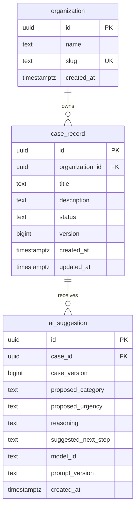

# Data Model

**Project:** Enterprise AI Service Operations & Intelligence Platform  
**Status:** Proposed — to be reviewed before the first migration

## 1. Purpose and scope

This document describes the initial relational model for the service-case workflow. It covers three entities: the customer organization, the service case it owns, and the AI suggestions generated for that case.

It supports the Week 1 requirements: storing a case under an owning organization, rejecting invalid records, generating an AI suggestion, and keeping the case's status independent of that suggestion (see [requirements](requirements.md) and [architecture context](architecture-context.md), DEC-001 to DEC-003).

Users, assignment, review decisions, case history, and knowledge sources are deliberately out of scope for this first version. This is a design proposal, not a description of an implemented schema.

## 2. Entities and attributes

### `organization`

A customer organization served by the provider.

| Attribute | Type | Purpose |
|---|---|---|
| `id` | `uuid` | Unique organization identifier; primary key. |
| `name` | `text` | Human-readable organization name. |
| `slug` | `text` | Unique short identifier. |
| `created_at` | `timestamptz` | Creation timestamp. |

### `case_record`

A service case. This table holds the authoritative case state.

| Attribute | Type | Purpose |
|---|---|---|
| `id` | `uuid` | Unique case identifier; primary key. |
| `organization_id` | `uuid` | Owning customer organization; required foreign key. |
| `title` | `text` | Short case description. |
| `description` | `text` | Detailed problem statement. |
| `status` | `text` | Authoritative lifecycle state. |
| `version` | `bigint` | Revision number, used to detect stale changes. |
| `created_at` | `timestamptz` | Creation timestamp. |
| `updated_at` | `timestamptz` | Last modification timestamp. |

Initial status values are `NEW`, `IN_REVIEW`, and `CLOSED`. These are starting values, not a final workflow policy; permitted transitions need their own rules.

`organization_id` identifies the **owning customer organization**. It does not identify an assigned service engineer. A case can exist before anyone is assigned, and no `assigned_engineer_id` is added until a user model and assignment rules are defined.

### `ai_suggestion`

A structured triage suggestion produced by a model for one revision of a case.

| Attribute | Type | Purpose |
|---|---|---|
| `id` | `uuid` | Unique suggestion identifier; primary key. |
| `case_id` | `uuid` | Case the suggestion was generated for; required foreign key. |
| `case_version` | `bigint` | Case revision used to generate the suggestion. |
| `proposed_category` | `text` | AI-suggested category. |
| `proposed_urgency` | `text` | AI-suggested urgency. |
| `reasoning` | `text` | Explanation returned by the model. |
| `suggested_next_step` | `text` | Proposed action or investigation. |
| `model_id` | `text` | Model that produced the suggestion. |
| `prompt_version` | `text` | Version of the prompt definition. |
| `created_at` | `timestamptz` | Suggestion creation timestamp. |

During Week 1, the raw model invocation evidence is stored separately under `evaluations/`. A dedicated model-execution record may be introduced later.

## 3. Relationships

**One organization owns many cases.** An organization may have hundreds of cases, so the reference is stored on the "many" side: `case_record.organization_id`. The organization does not hold a list of case IDs. Every case has exactly one owning organization.

**One case receives many AI suggestions.** A case may be analyzed more than once, for example when first opened and again after new information is added. `ai_suggestion.case_id` is therefore not unique. Every suggestion belongs to exactly one case.

**A suggestion belongs to a specific case revision.** If a suggestion was generated from case version 3 and an engineer later updates the case to version 4, the older suggestion may be stale. Recording `case_version` lets the application detect this when deciding whether an approval or action still applies. The column alone does not provide concurrency safety; application operations and database transactions will enforce that later.

## 4. Integrity rules

These rules belong to the model, not just the diagram. Where a rule is enforced by the database, an invalid write is rejected rather than corrected.

**Ownership and references**

- `case_record.organization_id` and `ai_suggestion.case_id` are `NOT NULL`. A case cannot exist without an owner, and a suggestion cannot exist without a case.
- Foreign keys reject references to organizations or cases that do not exist.
- `organization.slug` is unique.

**Required values**

- Identifiers, `name`, `slug`, `title`, `status`, `version`, `case_version`, `model_id`, `prompt_version`, and all timestamps are `NOT NULL`.
- Suggestion content fields are stored only after the model output has passed schema validation (DEC-002). Which of them may be empty is an open decision.

**Valid status values**

- `case_record.status` must be one of `NEW`, `IN_REVIEW`, or `CLOSED`. The database rejects any other value.
- Allowed transitions between those values are enforced by application operations, not by this constraint alone.

**Revisions**

- `case_record.version` starts at 1 and increases with each meaningful change to the case.
- `ai_suggestion.case_version` must equal the referenced case's version at the moment the suggestion is created. The application must read the case and insert the suggestion consistently. A plain foreign key cannot check this, because only the current version is stored.

**Deletion**

- A record must not silently lose its history through unintended cascading deletion. Until a deletion and retention policy is agreed, foreign keys do not use `ON DELETE CASCADE`, so deleting an organization with cases, or a case with suggestions, is rejected.

**Separation of case state and AI suggestions**

- `case_record.status` is the only authoritative case state. Nothing in `ai_suggestion` changes it.
- A suggestion is an input to a human decision. Accepting a suggestion and changing case state are separate operations (DEC-003).

**Authorization is not provided by foreign keys**

- A foreign key proves that a referenced organization or case exists. It does not prove that the user or service making the request is allowed to access it.
- Every read and write must be scoped to the caller's permitted organizations by the application (and later, possibly, by database row-level security).
- `ai_suggestion` has no `organization_id` of its own; its organization is reached through `case_record`. Queries for suggestions must therefore join through the case and apply the organization filter. This is the starting point for the later multi-tenancy work.

## 5. Open decisions

These items are deliberately deferred and should be settled by small design decisions and tests:

- **Status transitions:** which moves between `NEW`, `IN_REVIEW`, and `CLOSED` are allowed, and by which role.
- **Category and urgency values:** whether suggestion fields use a fixed vocabulary, and how unknown model values are handled.
- **Users and assignment:** the user model, role membership per organization, and case assignment.
- **Case history:** how the traceable history in FR-03 is stored (for example, a history table or event records).
- **Review decisions:** how an engineer's decision on a specific suggestion is recorded and linked to `case_version` (FR-06, FR-07).
- **Model execution record:** whether invocation details (latency, token usage, raw output, errors) move from `evaluations/` into the database.
- **Tenant key on suggestions:** whether to copy `organization_id` onto `ai_suggestion`, with a composite foreign key that keeps it consistent with the case, to support row-level security.
- **Deletion and retention:** when organizations, cases, and suggestions may be deleted, archived, or anonymized.
- **Implementation details:** how UUIDs are generated, whether status uses a `CHECK` constraint, enum, or lookup table, and how `version` and `updated_at` are maintained.
