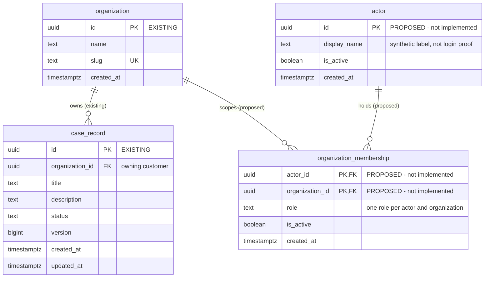
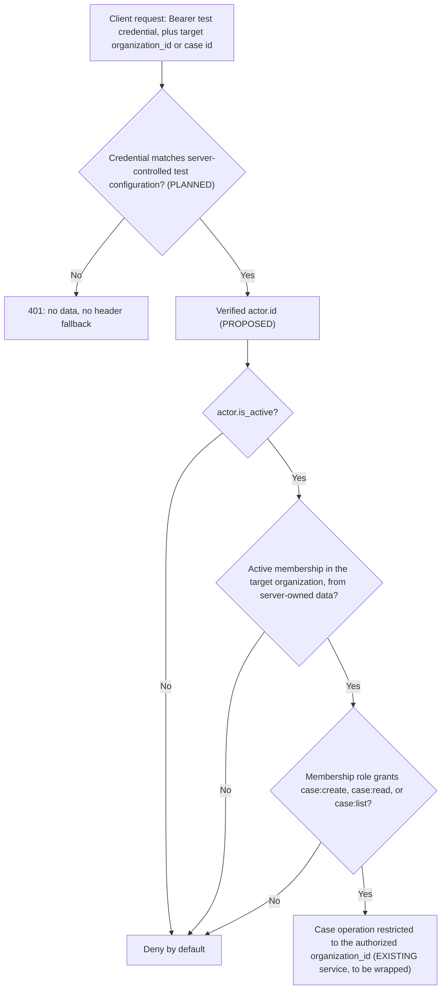
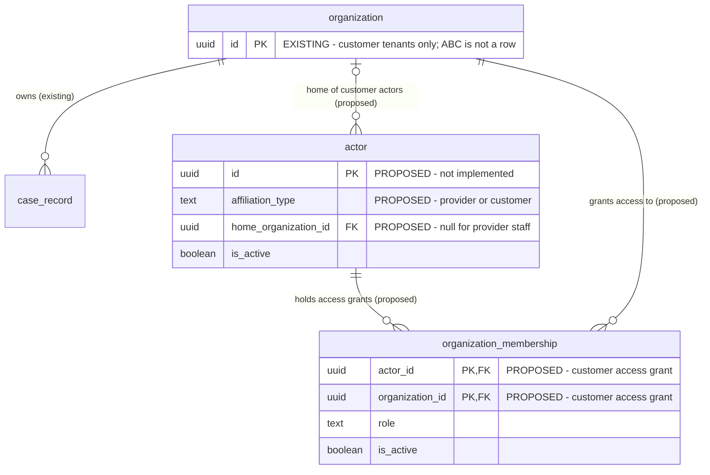

# Actor and Organization Membership — Proposed Relational Model

**Project:** Enterprise AI Service Operations & Intelligence Platform  
**Status:** **Proposed / design only.** The surrounding identity and authorization architecture is accepted in [ADR-0005](adr/0005-server-verified-identity-and-tenant-authorization.md), and the affiliation and role-eligibility design in [ADR-0006](adr/0006-actor-affiliation-and-role-grant-eligibility.md). The `actor` and `organization_membership` entities, credential verification, authorization checks, and HTTP endpoints described here are **not implemented**. No migration, fixture, policy code, or test exists for them.  
**Scope:** The normalized data model that would let the platform represent which actors belong to which customer organizations, and in which role. Choosing an authentication provider, implementing enforcement, and recording permission-test results are out of scope.  
**Evidence class:** Design only. The SQL, permission matrix, and flows below have not been executed or tested.

## 1. Problem statement

The existing [`organization`](../db/001_init.sql) table identifies the customer that owns each case. The repository cannot represent a person or service principal, or say which organizations that principal may work with. The local case service in [`src/case_service.py`](../src/case_service.py) accepts an organization UUID from its caller and uses it as a query filter. That is **query scoping, not tenant authorization**. The [API contract](api-contract.md) requires a verified actor, server-owned membership data, and an action-specific permission check before any case operation.

Three concerns are often merged. This document addresses only the second:

| Concern | Question it answers | Covered here? |
|---|---|---|
| **Authentication** | Which actor is making this request? (A credential is verified and resolved to an `actor.id`.) | No. The API contract proposes a test-only bearer credential; its verification is not designed here. |
| **Membership representation** | Which organizations is this actor related to, in which role, and is that relationship active? | **Yes.** This document covers it. |
| **Enforcement** | Given a verified actor, an action, and a target, is the request allowed, and is the case operation restricted to the authorized scope? | Only the data the policy needs and its intended outcomes. No policy code is designed. |

A well-normalized membership table **records** relationships. It does not authenticate anyone or enforce anything by itself. A foreign key proves that a membership refers to a real organization. It does not prove that the caller is that member.

**Design goals.** The model must support:

1. Actors who belong to one or several organizations.
2. Different roles in different organizations.
3. Deactivating an actor, or one of its memberships, without deleting historical rows.
4. Default-deny decisions when data is absent or inactive.

It must not add identity, role, or organization-name columns to `case_record` merely to avoid joins.

**Related documents:**

- [Requirements](requirements.md): FR-01, FR-02, and FR-03, and the roles in [section 3](requirements.md#3-users-and-responsibilities).
- [API contract](api-contract.md): the authorization rule and the normalization section.
- [Current data model](data-model.md).
- [System context](system-context.md#4-capability-status).
- [Architecture context](architecture-context.md).
- [ADR index](adr/README.md).

[ADR-0001](adr/0001-postgresql-authoritative-case-store.md) and [ADR-0003](adr/0003-application-controlled-case-transitions.md) govern authoritative state and application-controlled operations. [ADR-0005](adr/0005-server-verified-identity-and-tenant-authorization.md), **Accepted** on 2026-11-15, sets the architectural direction for server-verified identity and organization-scoped authorization, and this document is one of its inputs. Acceptance is architectural only:

- the `actor` and `organization_membership` model described here remains **unimplemented**;
- no authentication or authorization mechanism has been built or validated.

## 2. Existing versus proposed entities

| Entity | Status | Primary key | Responsibility |
|---|---|---|---|
| `organization` | **Implemented** ([`db/001_init.sql`](../db/001_init.sql)) | `id UUID`, `DEFAULT gen_random_uuid()`; `slug` is `UNIQUE` | Customer identity and case ownership |
| `case_record` | **Implemented** ([`db/001_init.sql`](../db/001_init.sql)) | `id UUID`; `organization_id` FK `ON DELETE RESTRICT` | Authoritative case and its owning organization |
| `ai_suggestion` | **Implemented**, unchanged by this design | `id UUID`; `case_id` FK | Non-authoritative model output |
| `case_status_event` | **Implemented** ([`db/002_case_status_events.sql`](../db/002_case_status_events.sql)), unchanged by this design | `id UUID`; `case_id` FK | Status-transition history with a caller-supplied `actor_label` |
| `actor` | **Proposed, not implemented** | `id UUID` | Stable internal reference to an application principal; not a credential |
| `organization_membership` | **Proposed, not implemented** | Composite `(actor_id, organization_id)` | One actor's role and active state in one organization |
| `case_creation_idempotency` | Accepted design in [ADR-0004](adr/0004-keyed-idempotent-case-creation.md), not implemented; out of scope here | — | Keyed create-request replay detection |

`case_status_event.actor_label` is unverified text. Adding an `actor` table does **not** make existing or future labels verified attribution. Linking events to `actor.id` is an open decision (section 11).

### Entity relationship diagram

Only `organization` and `case_record` exist today. `actor` and `organization_membership` are proposals, and each attribute comment says so.



The proposed affiliation refinement (`affiliation_type`, `home_organization_id`) is not shown here. See [section 10](#10-provider-affiliation-vs-customer-access-grants).

There is deliberately **no** relationship between `actor` and `case_record`. The model does not record case assignment or requester ownership. It also does not imply that every member may read every case in an organization. Assignment and requester-owned access are separate future relationships.

## 3. Proposed `actor`

| Attribute | Type | Proposed constraint | Meaning and rationale |
|---|---|---|---|
| `id` | `uuid` | `PRIMARY KEY DEFAULT gen_random_uuid()` | Stable internal principal reference, generated by the database like the existing keys. It is never derived from a name or credential. |
| `display_name` | `text` | `NOT NULL`, `CHECK (BTRIM(display_name) <> '')`; **not** unique | Synthetic, human-readable label for local demonstrations and logs, for example a fictional role description. It has no other meaning. |
| `is_active` | `boolean` | `NOT NULL DEFAULT TRUE` | A deactivated actor is denied every action, whatever memberships it holds. |
| `created_at` | `timestamptz` | `NOT NULL DEFAULT NOW()` | Row creation time. It is not a login or activation timestamp. |

**Why `display_name` is not login proof.** Authentication verifies a credential held by the caller and resolves it to an `actor.id`. A display name is ordinary data that anyone can type:

- It is not unique, so two actors may share one.
- It is not secret, so knowing it proves nothing.
- It is not bound to any credential.
- It may change without changing who the actor is.

**Affiliation.** Two further attributes, `affiliation_type` and `home_organization_id`, are **accepted** as design in [ADR-0006](adr/0006-actor-affiliation-and-role-grant-eligibility.md) and described in [section 10](#10-provider-affiliation-vs-customer-access-grants). They are not implemented, and they are not authorization inputs.

Matching a request to an actor by display name, or accepting a display name from a header, would let any caller claim to be anyone. Policy code should therefore never read `display_name`; it is for display only.

**What `actor` does not store.** The table holds no credentials, password hashes, tokens, email addresses, or external identity-provider subjects. The [API contract](api-contract.md#3-api-design-choices-proposed) proposes mapping a locally configured opaque test credential to an `actor.id` through server-controlled configuration that clients cannot edit. Working credentials must not be committed. Production login, token storage and rotation, identity-provider subjects, and service-to-service principals are open decisions (section 11).

## 4. Proposed `organization_membership`

| Attribute | Type | Proposed constraint | Meaning and rationale |
|---|---|---|---|
| `actor_id` | `uuid` | `NOT NULL`, FK → `actor(id) ON DELETE RESTRICT`; part of the PK | The member. |
| `organization_id` | `uuid` | `NOT NULL`, FK → `organization(id) ON DELETE RESTRICT`; part of the PK | The customer organization the membership applies to. Mirrors the existing `case_record.organization_id` FK behavior. |
| `role` | `text` | `NOT NULL`, `CHECK (role IN ('service_engineer', 'service_manager', 'requester'))` | The **single** role this actor holds in this organization. Uses the API contract's vocabulary. |
| `is_active` | `boolean` | `NOT NULL DEFAULT TRUE` | An inactive membership grants nothing. |
| `created_at` | `timestamptz` | `NOT NULL DEFAULT NOW()` | When the membership row was created. |

**A membership is a customer access grant, not employment.** An ABC engineer can hold grants for several customers without being employed by any of them ([section 10](#10-provider-affiliation-vs-customer-access-grants)).

**Primary key `(actor_id, organization_id)`.** The design assumes **one membership row and one role per actor per organization**. Under that assumption the pair identifies the relationship, and `role` depends on the whole pair (section 5). The key also prevents duplicate or contradictory rows: an actor cannot be both an active `requester` and an inactive `service_manager` in the same organization. If one actor ever needs several roles in one organization, this key is wrong. The schema would then need `(actor_id, organization_id, role)` as the key, or a separate membership-role relation with its own active state. That would be a deliberate schema change, not a data workaround.

**`platform_administrator` is not a membership role.** The role appears in the [requirements](requirements.md#3-users-and-responsibilities) but is excluded from the `role` check. It carries **no implicit right** to read customer cases. Platform-wide administration or delegated customer access needs its own decision and must not be added as an unrestricted bypass.

**Deletion and revocation semantics (proposed):**

- **Revoking a membership** sets `is_active = FALSE`. The row stays, so the system can show that the relationship existed.
- **Re-granting** reactivates the same row, because the composite key forbids a second row for the pair. Changing a role updates `role` in place.

  Both operations overwrite the previous state. This design keeps **no history** of role changes or of active and inactive periods, and it has no `updated_at` column. If membership changes must be auditable, as the requirements' auditability rule may demand, that needs a separate history design.
- **Deactivating an actor** sets `actor.is_active = FALSE`. Policy then denies the actor even if its memberships are still active, and no cascade is needed.
- **Hard-deleting an actor or organization** is blocked by `ON DELETE RESTRICT` while membership rows reference it. This matches the existing tables, where retention and offboarding are still deferred ([data model §7](data-model.md#7-deferred-decisions)).
- **Hard-deleting a membership row** is not blocked by any FK, because nothing references the membership. Whether revocation may ever delete a row, or must always deactivate it, needs review before implementation.

**Indexes.** The primary key creates a unique B-tree index on `(actor_id, organization_id)`. It serves the actor-first lookup in section 7. PostgreSQL does **not** create indexes on referencing FK columns. So lookups starting from the organization, such as "list the members of an organization", or `RESTRICT` checks when deleting an organization, would scan the table without a separate index on `organization_id`. No such index is proposed yet. Add it when that query shape exists and its plan has been inspected.

## 5. Functional dependencies and normalization

| Relation | Functional dependencies | Notes |
|---|---|---|
| `organization` (existing) | `id → name, slug, created_at`; `slug → id` | `slug` is a candidate key (`UNIQUE NOT NULL`). |
| `case_record` (existing) | `id → organization_id, title, description, status, version, created_at, updated_at` | No actor or role attributes. |
| `actor` (proposed) | `id → display_name, is_active, created_at` | `display_name` determines nothing. |
| `organization_membership` (proposed) | `(actor_id, organization_id) → role, is_active, created_at` | Neither `actor_id` alone nor `organization_id` alone determines `role`. |

If the affiliation attributes proposed in [section 10](#10-provider-affiliation-vs-customer-access-grants) are approved, `actor.id → affiliation_type, home_organization_id` is added.

In each relation, every non-trivial determinant is a key, so the proposed relations are in Boyce–Codd normal form under these dependencies.

**Why a multi-organization actor needs a join table.** A staff member may serve two customer organizations, with a different role in each. Several alternatives fail:

- **A single `actor.organization_id` column** can hold only one membership, so a legitimate second membership is lost.
- **A comma-separated list of organization IDs** breaks first normal form. It cannot carry FK validation, and revoking one membership means rewriting a string.
- **`actor.role`** is wrong because the role depends on the (actor, organization) pair, not on the actor. A service manager in one organization may be a requester in another.

The relationship is many-to-many, and its attributes belong to the pair. `organization_membership` stores it at that grain.

**Why roles are not copied into `case_record`.** A case has no actor. Its owner is an organization. Copying a role, actor ID, or organization name onto each case would store, many times over, facts that change independently of the case. Revoking a membership or changing a role would then mean updating every affected case, and any missed row would keep stale authority, which is an update anomaly with security impact. Authorization should be evaluated against the current membership row at request time, not against a copy on a row.

**Tradeoff.** Authorization adds a membership lookup, or a join, to each protected operation. That cost keeps access rules at the right grain. Nothing is denormalized for unmeasured speed (see [API contract §9](api-contract.md#9-normalization-and-data-shape)).

## 6. Intended trust flow

Authority flows in one direction: a verified credential, then a verified actor, then an active membership, then a role permission, then a scoped case operation. It never flows from a request header, a request body, a model response, or a guessed UUID.



1. **Authenticate.** A future HTTP boundary verifies a locally configured, test-only opaque credential and resolves it to an `actor.id` from server-controlled configuration. Arbitrary `X-User-Id`, `X-Actor-Id`, or `X-Org-Id` headers, and decoded but unverified tokens, are never identity.
2. **Check the actor.** `actor.is_active` must be true.
3. **Determine the target organization.**
   - For `POST /cases` and `GET /cases`, the client nominates `organization_id`. This only selects the target and **grants nothing**.
   - For `GET /cases/{id}`, the target is the case's **actual** `organization_id` as stored in `case_record`, never an owner claimed by the client.
4. **Check the membership.** An active `organization_membership` row must exist for `(actor.id, target organization)`.
5. **Check the permission.** The membership's role must grant the specific action (section 8).
6. **Operate in scope.** The case operation uses the **authorized** organization ID, for example `WHERE id = $case AND organization_id = $authorized_org`. This predicate is defense in depth after authorization, not a substitute for it. A newly created case's organization comes from the successful policy decision, not from passing the client's UUID straight through.
7. **Deny without disclosure.**
   - A forbidden explicit target for create or list returns `403` with no rows.
   - A missing or inaccessible single case returns a nondisclosing `404`.
   - There is never a fallback to all organizations.

The existing `transition_case()` stays unauthenticated local code and is not exposed over HTTP ([ADR-0003](adr/0003-application-controlled-case-transitions.md)).

**Consequence for tenant IDs.** Under this policy, a client-supplied `organization_id` can only **narrow** a request to an organization where the verified actor already holds an active, permitting membership. It can never widen access. Because the actor ID is taken only from credential resolution, a client cannot change whose memberships are evaluated.

## 7. Illustrative membership lookup

> **Design-only.** This query is not in any migration or source file and has not been executed. It shows the intended lookup shape for review.

```sql
-- $1: actor.id resolved from a verified credential (never from a request header)
-- $2: target organization (client-nominated for create/list; the case's stored owner for read)
SELECT m.role
FROM actor AS a
JOIN organization_membership AS m
  ON m.actor_id = a.id
WHERE a.id = $1
  AND a.is_active = TRUE
  AND m.organization_id = $2
  AND m.is_active = TRUE;
```

- **Zero rows means deny.** An empty result never falls back to broader scope.
- **A returned role is not yet permission.** Application policy must still check that the role grants the requested action (section 8). An unrecognized role means deny.
- **Check/use race.** If this lookup runs as a separate step before the case operation, a membership or actor revoked in between does not stop an operation already authorized: a time-of-check to time-of-use gap. Options to evaluate before implementation:
  - Run authorization and the protected read or write in the same transaction, or the same statement. For example, join the membership predicate into the case query.
  - Lock the actor row, then the membership row, `FOR SHARE`, so that a concurrent revocation waits. **Not** `FOR KEY SHARE`: it does not block updates to non-key columns such as `is_active` or `role`. This is the write strategy accepted in ADR-0005.
  - Explicitly accept that revocation applies only to requests that start after it commits.

  Even a single statement sees a snapshot, so a revocation that commits during the statement does not affect it. [ADR-0005](adr/0005-server-verified-identity-and-tenant-authorization.md) (Accepted) settles a **minimum** revocation contract, not instant revocation:
  - single scoped statements for reads and lists;
  - short READ COMMITTED write transactions that lock the actor, then the membership, `FOR SHARE`;
  - no cached decisions.

  The contract is untested. These options and their PostgreSQL lock semantics are compared in the [authentication and authorization sequence](authentication-authorization-sequence.md#8-checkuse-timing-and-revocation).
- **Row-level security** in PostgreSQL remains optional defense in depth. It does not replace a verified actor.

## 8. Provisional permissions

These permissions match the [API contract authorization rule](api-contract.md#authorization-rule-accepted-in-adr-0005). They are **not** an implementation and have not been tested. The detailed policy proposal, including predicates, HTTP outcomes, and proposed test vectors, is in [Case authorization — minimum role-permission policy](authorization-permissions.md).

| Membership state and role | `case:create` | `case:read` | `case:list` | Status transition over HTTP |
|---|---|---|---|---|
| Active `service_engineer` | Allow in member organization | Allow in member organization | Allow in member organization | Not exposed |
| Active `service_manager` | Allow in member organization | Allow in member organization | Allow in member organization | Not exposed |
| Active `requester` | Allow in member organization only (create-only; [accepted in ADR-0005](authorization-permissions.md#requester-create-only-accepted-in-adr-0005), not implemented) | Deny until per-case requester ownership is modeled | Deny | Not exposed |
| `platform_administrator` without an explicit, separately decided delegation | No implicit access | No implicit access | No implicit access | No implicit access |
| No membership in the target organization | Deny | Deny (nondisclosing `404`) | Deny (`403`) | Deny |
| Inactive actor, inactive membership, or unrecognized role | Deny | Deny | Deny | Deny |

Every rule is scoped to one organization. Membership in organization A grants nothing in organization B. Any combination not listed is denied. [ADR-0005](adr/0005-server-verified-identity-and-tenant-authorization.md) accepts requester create-only and `403` for an inactive actor with a valid credential. Any platform-administrator exception would need a separate decision.

## 9. Key strategy

- **Existing keys are unchanged.** `organization`, `case_record`, `ai_suggestion`, and `case_status_event` keep their UUID primary keys generated by `gen_random_uuid()`, which produces version-4 random UUIDs. It has been built into PostgreSQL since version 13; the project runs PostgreSQL 16.
- **`actor.id` is a UUID** generated the same way, for consistency. Actors need a stable identity that is independent of any credential or display label.
- **`organization_membership` has no independent UUID.** The pair `(actor_id, organization_id)` already identifies the relationship. A surrogate `id` would still require a `UNIQUE (actor_id, organization_id)` constraint to prevent duplicates. That means two indexes instead of one, and a second identity for the same fact. Add a membership UUID only if the relationship gains an independent identity or lifecycle. Examples: external systems referencing a membership by ID, or several membership periods per pair that must be told apart.
- **Size.** PostgreSQL `uuid` is 16 bytes, compared with 8 bytes for `bigint`. Each composite membership key holds two UUIDs, so each index entry carries 32 bytes of key data. At the synthetic scale of this project, that size has not been measured and is not expected to decide the design. It should be measured, not assumed, before any change.
- **Write locality.** Random version-4 UUIDs insert into scattered B-tree pages, whereas increasing keys append at one end. That can mean more page splits and cache misses on large indexes. No measurement exists for this workload. Time-ordered identifiers, such as UUIDv7 generated by the application or by the built-in `uuidv7()` in PostgreSQL 18 and later, should be evaluated only if measurements justify it. This design does not change the key strategy.
- **UUIDs are identifiers, not authorization tokens.** A UUID that is hard to guess does not replace a policy check.

References: [PostgreSQL 16 UUID type](https://www.postgresql.org/docs/16/datatype-uuid.html), [UUID functions](https://www.postgresql.org/docs/16/functions-uuid.html), and [constraints](https://www.postgresql.org/docs/16/ddl-constraints.html).

## 10. Provider Affiliation vs Customer Access Grants

**Status:** **Affiliation and eligibility design accepted in ADR-0006 (2026-11-15). Not implemented.**

- **Accepted design:** the affiliation model (Option B) and the role-eligibility invariant are **accepted** in [ADR-0006](adr/0006-actor-affiliation-and-role-grant-eligibility.md). ADR-0006 owns the decision rationale and the eligibility rules; this section explains the entities and the schema alternatives.
- **Unimplemented schema:** the `actor` columns (`affiliation_type`, `home_organization_id`) and the `organization_membership` relation do not exist.
- **Unimplemented enforcement:** no provisioning validation, eligibility trigger, or database constraint exists.
- **Unexecuted tests:** no security or concurrency test of these rules has run.

- It does not change the accepted authorization contract in [ADR-0005](adr/0005-server-verified-identity-and-tenant-authorization.md).
- Nothing here is a migration, fixture, or permission.
- All people and organizations named below are fictional.

### 10.1 Business context

The platform is operated by a single, fictional managed IT service provider, **ABC Company**. ABC employs the service engineers, service managers, and platform administrators who run the platform and support customers.

**Organization A** and **Organization B** are customer organizations. Their staff submit support cases to ABC, and each customer is a row in the existing [`organization`](../db/001_init.sql) table, which owns that customer's cases.

ABC staff investigate and resolve cases only for the customers they have been explicitly authorized to support.

**ABC is not a customer tenant.** It is the implicit platform provider and is **not** inserted into `organization`. Adding it would make ABC a valid case owner, a valid `organization_id` selector, and a valid membership target. It would also break the property every isolation rule relies on, namely that each `organization` row is a separately owned customer tenant. Every tenant query and policy check would then have to exclude the provider row explicitly. That change would need its own decision.

### 10.2 Identity, affiliation, and access grant

| Concept | Question it answers | Representation | Example | Is it authorization? |
|---|---|---|---|---|
| **Actor identity** | Who is performing this operation? | Proposed `actor` row, resolved from a server-verified credential (ADR-0005) | Ali | No. It identifies the caller and grants nothing by itself. |
| **Organizational affiliation** | Which organization does this person belong to, in the business sense? | Not modeled today; see the options in 10.4 | Ali works for ABC; Ahmed works for Organization A | **No.** Affiliation never grants case access. |
| **Customer access grant** | Which customer organization may this actor access, and with which role? | Proposed `organization_membership` row | Ali holds a `service_engineer` grant for Organization A and another for Organization B | **Yes**, together with an active actor and the role's permission (ADR-0005) |

An ABC engineer can hold access grants for both customers **without being employed by either**. Affiliation and access grants are different facts and must never be used interchangeably:

- employment by a customer does not imply access to its cases;
- an access grant does not imply employment.

**Naming.** Despite its name, an `organization_membership` row is a **customer access grant**, not a record of employment. This document keeps the name for consistency with ADR-0005 and the other design documents; ADR-0006 keeps the name.

### 10.3 Illustrative actors

These relationships are **illustrative only**. They are not implemented identities, fixtures, or permissions.

| Actor | Affiliation | Responsibility | Access grants (`organization_membership` rows) | Case permissions under ADR-0005 |
|---|---|---|---|---|
| Ahmed | Organization A | Requester | (A, `requester`) | Create in A only; no read or list |
| Fatima | Organization B | Requester | (B, `requester`) | Create in B only; no read or list |
| Ali | ABC | Service engineer | (A, `service_engineer`), (B, `service_engineer`) | Create, read, list in A; separately, in B |
| Sara | ABC | Service manager | (A, `service_manager`), (B, `service_manager`) | Create, read, list in A; separately, in B |
| Bilal | ABC | Platform administrator | None | **No** customer-case access |

**Each grant is separate.** Ali's access to A and to B is two explicit rows. Revoking the B grant leaves A unaffected, and no grant for one customer implies access to another.

**Platform administration is not a role yet.** `platform_administrator` is not a membership role, and no platform-administration permission exists in the current model, so Bilal is simply an ABC actor with no grants.

### 10.4 Affiliation modeling options

| | Option A: no persisted affiliation | Option B: affiliation attributes on `actor` | Option C: separate affiliation relation |
|---|---|---|---|
| **Shape** | Existing proposal unchanged; affiliation exists only in documentation and fixture naming conventions | `affiliation_type` (`provider` or `customer`) and a nullable `home_organization_id` FK to `organization` | An `actor_affiliation(actor_id, affiliated_party, …)` relation, possibly with an organization or party type model |
| **Distinguishes ABC staff from customer staff** | Only by convention; not queryable or enforceable | Yes: `provider` means ABC; `customer` plus `home_organization_id` means a specific customer | Yes |
| **Valid-state constraints** | None possible | One conditional `CHECK` (below) | Per-row constraints, but a "provider" party must be modeled somehow, which risks putting ABC into a tenant table |
| **Multiple affiliations (contractors, consultants)** | Not representable | One affiliation per actor only | Supported |
| **Can role eligibility be enforced?** | No: nothing to check against | Yes, by provisioning validation or a database mechanism (10.6) | Yes, but more joins and rules |
| **Complexity** | Lowest | Low: two columns and one constraint | Highest: a new table, its keys and lifecycle, and possibly a party model |

The Option B constraint is a **design sketch only**; it has not been executed:

```sql
-- Proposed actor attributes (design sketch only, not executed)
affiliation_type     text NOT NULL CHECK (affiliation_type IN ('provider', 'customer')),
home_organization_id uuid NULL REFERENCES organization(id) ON DELETE RESTRICT,
CONSTRAINT actor_affiliation_consistent CHECK (
     (affiliation_type = 'provider' AND home_organization_id IS NULL)
  OR (affiliation_type = 'customer' AND home_organization_id IS NOT NULL)
)
```

**Is one customer affiliation per actor reasonable?** For the current scenario it is: each requester works for exactly one customer, and ABC staff have no customer affiliation. It stops being reasonable for:

- consultants who work for several customers;
- third-party contractors engaged by ABC;
- people who change employers but must keep their history.

Those cases point to Option C, adopted through a later forward-only migration.

### 10.5 Adopted affiliation model (ADR-0006)

[ADR-0006](adr/0006-actor-affiliation-and-role-grant-eligibility.md) **accepted** this model on 2026-11-15. The attributes `affiliation_type` and `home_organization_id` are accepted design and **not yet implemented**.

**Option B, in the first identity migration.** It is the simplest model that makes the provider/customer boundary explicit and checkable without adding a party model. Option A leaves a security-relevant fact ambiguous. Option C adds complexity that the current single-provider scenario does not need.

- **Persist affiliation in the first identity migration.** Add the two `actor` attributes and the `actor_affiliation_consistent` constraint above. Changing this later would require a backfill and a migration of existing actors.
- **Affiliation is server-managed.** It is set only by server-side provisioning (local fixtures or a future administrative path), never from an API request body, header, or credential claim. No endpoint changes it in this increment.
- **Affiliation is not an authorization input.** The ADR-0005 policy is unchanged: authorization reads only `actor.is_active`, the active `organization_membership` row for the evaluated organization, and that row's role. Affiliation never grants, widens, or substitutes for an access grant.
- **ABC staff and multiple customers.** An ABC actor (`affiliation_type = 'provider'`, `home_organization_id IS NULL`) holds one `organization_membership` row per customer it supports, each created explicitly.
- **Customer requesters.** A customer actor has `affiliation_type = 'customer'` and `home_organization_id` set to its own organization, plus a `requester` grant for that same organization.
- **Membership name.** Keep `organization_membership` for consistency with ADR-0005, defined explicitly as a customer access grant (10.2). ADR-0006 accepted keeping the name.
- **Future contractors and service principals.**
  - Contractors with several affiliations would move to Option C through a new migration; Option B's columns can be backfilled into the new relation.
  - Service principals, meaning non-human actors, need an actor-kind decision of their own. They are not covered by this recommendation.

Proposed ER refinement (not implemented):



**Normalization.** Under Option B, `actor.id → affiliation_type, home_organization_id`, and the relation stays in BCNF. Affiliation is a single-valued property of the actor, while the role remains a property of the (actor, organization) grant (section 5).

### 10.6 Role eligibility is a separate decision

Three layers must not be confused:

| Layer | Content | Status |
|---|---|---|
| **1. Role permissions** | What each role may do once granted: engineer and manager create, read, and list; requester create only; no implicit platform-administrator access; an active actor and membership are required | **Accepted** in [ADR-0005](adr/0005-server-verified-identity-and-tenant-authorization.md); not implemented |
| **2. Role eligibility** | Who may be **assigned** each role. The full matrix is in [ADR-0006](adr/0006-actor-affiliation-and-role-grant-eligibility.md); in summary:<br>• provider actors may hold `service_engineer` or `service_manager` grants, but no `requester` grants;<br>• customer actors may hold only `requester`, and only for their `home_organization_id`;<br>• customer actors never gain engineer or manager privileges;<br>• platform administrators get no implicit grants | **Accepted** in ADR-0006; not implemented |
| **3. Enforcement** | Where eligibility would be checked | Approach **accepted** in ADR-0006: controlled provisioning, plus membership-side and actor-side database guards with actor-first locking. **Not implemented.** No constraint, trigger, provisioning validation, or eligibility test exists. |

**An affiliation field does not prevent privilege escalation by itself.** Anyone able to insert an `organization_membership` row, or to change an actor's affiliation, can still grant privileges. Eligibility would have to be enforced at every path that **writes** grants or affiliation. The mechanisms considered are listed below. ADR-0006 adopts provisioning validation combined with trigger-based database guards, and explains why it prefers triggers over the composite key; nothing is implemented.

- **Server-side provisioning validation**, in the single provisioning path allowed to create or change grants, with a structural check that nothing else writes them.
- **Database enforcement:** either a trigger on `organization_membership`, or carrying `affiliation_type` into the grant through a composite foreign key to `actor(id, affiliation_type)` plus a `CHECK` on role. The composite key is controlled redundancy that needs `ON UPDATE CASCADE`.
- **A least-privilege database role** that cannot write grants outside the provisioning path. No such role exists today.

**Materiality.** Enforcing eligibility adds a new invariant to ADR-0005's architecture. ADR-0005 decides what a granted role may do, not who may receive one. The new invariant would constrain provisioning, add data that the trust boundary depends on, and could block legitimate cases, such as an ABC engineer submitting a case on a customer's behalf. That is a **material addition** that needs its own architecture decision before enforcement is implemented, either a new ADR or an explicit amendment approved by the architecture owner. That decision is recorded as [ADR-0006](adr/0006-actor-affiliation-and-role-grant-eligibility.md), **Accepted** on 2026-11-15. ADR-0005 is unchanged and did **not** itself approve affiliation-based eligibility.

### 10.7 Implications for the first identity migration

**Adopted direction (ADR-0006).** The first identity migration is to include:

- `actor` gains `affiliation_type`, `home_organization_id`, and `actor_affiliation_consistent`;
- `organization_membership` is unchanged;
- ABC is not inserted into `organization`;
- fictional fixtures follow the conventions in 10.3;
- membership-side and actor-side eligibility guards, and a controlled provisioning path, per ADR-0006.

None of this exists yet. It must be shown by PostgreSQL-backed tests, including concurrency tests, before provisioning is enabled. Also:

- the ADR-0005 authorization behavior, the permission matrix, and the proposed test vectors in the [permission policy](authorization-permissions.md) are unchanged;
- eligibility applies only when grants are written; it adds no request-time predicate.

### 10.8 Decision status

[ADR-0006](adr/0006-actor-affiliation-and-role-grant-eligibility.md) (Accepted 2026-11-15) **decided** questions 1–4. Questions 5 and 6 remain open.

1. Persist affiliation using Option B, or defer it as Option A. *Decided: Option B.*
2. Keep the name `organization_membership`, or rename it before the first migration (for example, to `organization_access_grant`). *Decided: keep the name.*
3. Whether to adopt affiliation-based role eligibility (10.6), and which enforcement mechanism to use. *Decided: the eligibility matrix, enforced by provisioning validation plus trigger-based guards (not implemented).*
4. Whether ABC staff may also hold `requester` grants, for example to submit cases on a customer's behalf. *Decided: denied; engineers create cases through their `service_engineer` grant.*
5. How platform administration is represented, if it ever needs permissions. ADR-0005 grants it no implicit customer access.
6. When to move to Option C for contractors or multiple affiliations, and how service principals are modeled.

## 11. Open decisions

- Affiliation and role eligibility: questions 1–4 are decided in [ADR-0006](adr/0006-actor-affiliation-and-role-grant-eligibility.md) (Accepted). Still open: platform-administration representation, contractors and multiple affiliations, and service principals ([section 10.8](#108-decision-status)).
- Credential verification and the actor mapping:
  - the configuration mechanism and comparison method for test credentials. The lifecycle contract, covering generation with a secure random generator, revocation, rotation that keeps the `actor.id`, and the `401`/`403` outcomes, is accepted in ADR-0005.
- Identity sources:
  - how `actor` relates to future identity-provider subjects;
  - how service-to-service principals are represented.
- Membership changes:
  - verification under concurrency of the minimum revocation contract accepted in ADR-0005 (section 7);
  - whether revocation may hard-delete a membership row;
  - whether membership changes need a history relation and an `updated_at` column.
- Roles:
  - whether one role per actor per organization is enough (section 4);
  - how requester-owned single-case access will be modeled.
- Platform administrators: platform-wide administration, and any delegated access to customer data.
- Enforcement:
  - how the structural no-bypass check is implemented. The central enforcement layer and transaction boundaries are accepted in ADR-0005.
- `case_status_event`: whether events gain a verified `actor_id` reference, and what happens to existing `actor_label` values.
- Case assignment: how an engineer is assigned to a case.
- Database controls:
  - optional row-level security;
  - a least-privilege application database role.
- Indexes beyond the primary keys, chosen from measured query plans.
- An ADR for actor identity and tenant authorization, comparing alternatives. This is [ADR-0005](adr/0005-server-verified-identity-and-tenant-authorization.md), **Accepted** on 2026-11-15 as architecture and not implemented. This document itself accepts nothing.

## 12. Implementation status

**Nothing in this document is implemented.** No migration creates `actor` or `organization_membership`, and the accepted affiliation attributes and eligibility guards (section 10, ADR-0006) do not exist. No seed data defines actors or memberships, no credential or policy code exists, and no permission test has run. The case service still treats `organization_id` as a caller-supplied query filter. This design **does not establish tenant authorization**.

The authorization architecture is accepted in [ADR-0005](adr/0005-server-verified-identity-and-tenant-authorization.md). A later implementation increment would add:

- a new forward-only migration (historical migrations are never edited);
- fictional fixtures;
- server-side policy code;
- HTTP integration tests with observed results.

## 13. Document review checklist

These are documentation-review items, not executed tests. A checked box means the statement was verified by inspecting this document, the migrations, ADR-0005, ADR-0006, the permission policy, and the API contract on 2026-11-15. It does **not** mean that anything is implemented.

- [x] Every mention of `actor` and `organization_membership` is labeled proposed or not implemented, and no text claims enforcement exists.
- [x] Column names and constraints cited for existing tables match [`db/001_init.sql`](../db/001_init.sql) and [`db/002_case_status_events.sql`](../db/002_case_status_events.sql).
- [x] One actor can hold independently active memberships with different roles in several organizations.
- [x] The composite key `(actor_id, organization_id)` is justified only by the one-role-per-organization assumption, and the consequence of dropping that assumption is stated.
- [x] Authentication, membership representation, and enforcement are kept distinct. `display_name` and request headers are never treated as identity.
- [x] A client-supplied organization ID can only narrow scope. A missing, inactive, or unrecognized membership, role, or actor is denied.
- [x] Requesters receive no general read or list permission, and platform administrators receive no implicit access to customer data.
- [x] The check/use race is flagged, and the minimum revocation contract in ADR-0005 is marked untested.
- [x] Relative links resolve, and the role vocabulary matches the [API contract](api-contract.md).
- [x] Section 10 does all of the following:
  - keeps ABC out of the customer-tenant table, and never describes ABC staff as employees of their assigned customers;
  - presents affiliation as distinct from authorization;
  - requires an explicit grant per customer;
  - presents affiliation-based role eligibility as accepted design in ADR-0006, and as not implemented or tested;
  - leaves the ADR-0005 permission behavior unchanged.
