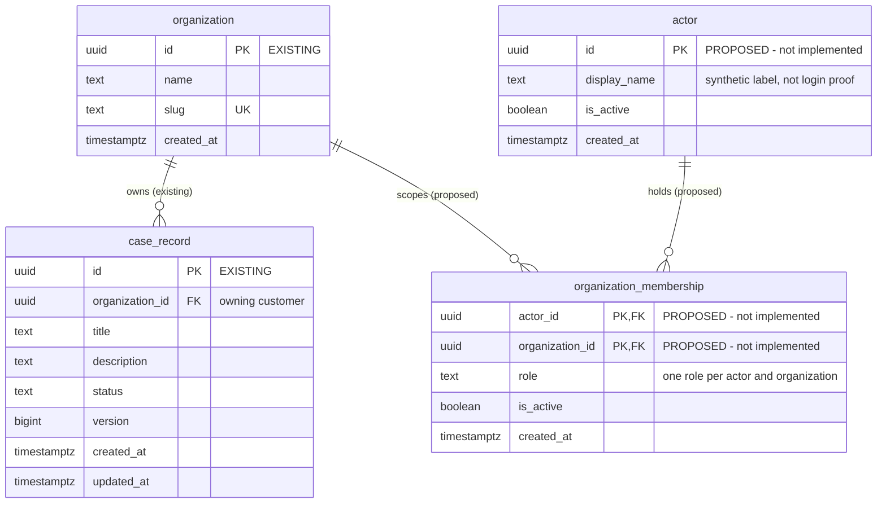
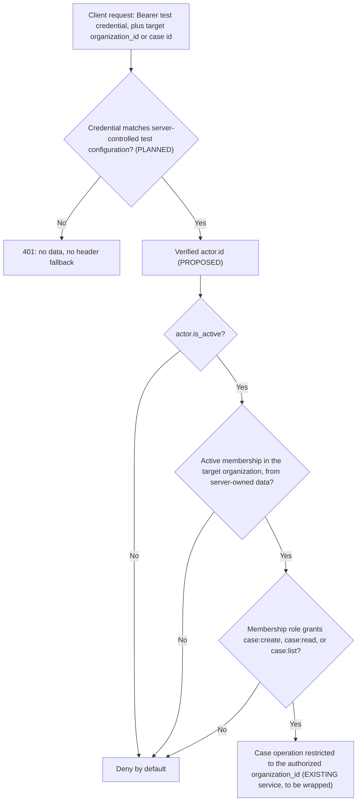

# Actor and Organization Membership — Proposed Relational Model

**Project:** Enterprise AI Service Operations & Intelligence Platform  
**Status:** **Proposed / design only.** The `actor` and `organization_membership` entities, credential verification, authorization checks, and HTTP endpoints described here are **not implemented**. No migration, fixture, policy code, or test exists for them.  
**Scope:** The normalized data model that would let the platform represent which actors belong to which customer organizations, and in which role. Choosing an authentication provider, implementing enforcement, and recording permission-test results are out of scope.  
**Evidence class:** Design only. The SQL, permission matrix, and flows below have not been executed or tested.

## 1. Problem statement

The existing [`organization`](../db/001_init.sql) table identifies the customer that owns each case. The repository cannot represent a person or service principal, or say which organizations that principal may work with. The local case service in [`src/case_service.py`](../src/case_service.py) accepts an organization UUID from its caller and uses it as a query filter. That is **query scoping, not tenant authorization**. The [API contract](api-contract.md) requires a verified actor, server-owned membership data, and an action-specific permission check before any case operation.

Three concerns are often merged. This document addresses only the second:

| Concern | Question it answers | Covered here? |
|---|---|---|
| **Authentication** | Which actor is making this request? (A credential is verified and resolved to an `actor.id`.) | No. The API contract proposes a test-only bearer credential; its verification is not designed here. |
| **Membership representation** | Which organizations is this actor related to, in which role, and is that relationship active? | **Yes.** This document covers it. |
| **Enforcement** | Given a verified actor, an action, and a target, is the request allowed, and is the case operation restricted to the authorized scope? | Only the data the policy needs and its intended outcomes. No policy code is designed. |

A well-normalized membership table **records** relationships. It does not authenticate anyone or enforce anything by itself. A foreign key proves that a membership refers to a real organization. It does not prove that the caller is that member.

**Design goals.** The model must support:

1. Actors who belong to one or several organizations.
2. Different roles in different organizations.
3. Deactivating an actor, or one of its memberships, without deleting historical rows.
4. Default-deny decisions when data is absent or inactive.

It must not add identity, role, or organization-name columns to `case_record` merely to avoid joins.

**Related documents:**

- [Requirements](requirements.md): FR-01, FR-02, and FR-03, and the roles in [section 3](requirements.md#3-users-and-responsibilities).
- [API contract](api-contract.md): the authorization rule and the normalization section.
- [Current data model](data-model.md).
- [System context](system-context.md#4-capability-status).
- [Architecture context](architecture-context.md).
- [ADR index](adr/README.md).

[ADR-0001](adr/0001-postgresql-authoritative-case-store.md) and [ADR-0003](adr/0003-application-controlled-case-transitions.md) govern authoritative state and application-controlled operations. Decisions on actor identity and tenant authorization are listed as **not yet recorded** in the [ADR backlog](adr/README.md#future-architecture-decisions--not-yet-recorded). This document informs those decisions but does not make them.

## 2. Existing versus proposed entities

| Entity | Status | Primary key | Responsibility |
|---|---|---|---|
| `organization` | **Implemented** ([`db/001_init.sql`](../db/001_init.sql)) | `id UUID`, `DEFAULT gen_random_uuid()`; `slug` is `UNIQUE` | Customer identity and case ownership |
| `case_record` | **Implemented** ([`db/001_init.sql`](../db/001_init.sql)) | `id UUID`; `organization_id` FK `ON DELETE RESTRICT` | Authoritative case and its owning organization |
| `ai_suggestion` | **Implemented**, unchanged by this design | `id UUID`; `case_id` FK | Non-authoritative model output |
| `case_status_event` | **Implemented** ([`db/002_case_status_events.sql`](../db/002_case_status_events.sql)), unchanged by this design | `id UUID`; `case_id` FK | Status-transition history with a caller-supplied `actor_label` |
| `actor` | **Proposed, not implemented** | `id UUID` | Stable internal reference to an application principal; not a credential |
| `organization_membership` | **Proposed, not implemented** | Composite `(actor_id, organization_id)` | One actor's role and active state in one organization |
| `case_creation_idempotency` | Proposed in [ADR-0004](adr/0004-keyed-idempotent-case-creation.md); out of scope here | — | Keyed create-request replay detection |

`case_status_event.actor_label` is unverified text. Adding an `actor` table does **not** make existing or future labels verified attribution. Linking events to `actor.id` is an open decision (section 10).

### Entity relationship diagram

Only `organization` and `case_record` exist today. `actor` and `organization_membership` are proposals, and each attribute comment says so.



There is deliberately **no** relationship between `actor` and `case_record`. The model does not record case assignment or requester ownership. It also does not imply that every member may read every case in an organization. Assignment and requester-owned access are separate future relationships.

## 3. Proposed `actor`

| Attribute | Type | Proposed constraint | Meaning and rationale |
|---|---|---|---|
| `id` | `uuid` | `PRIMARY KEY DEFAULT gen_random_uuid()` | Stable internal principal reference, generated by the database like the existing keys. It is never derived from a name or credential. |
| `display_name` | `text` | `NOT NULL`, `CHECK (BTRIM(display_name) <> '')`; **not** unique | Synthetic, human-readable label for local demonstrations and logs, for example a fictional role description. It has no other meaning. |
| `is_active` | `boolean` | `NOT NULL DEFAULT TRUE` | A deactivated actor is denied every action, whatever memberships it holds. |
| `created_at` | `timestamptz` | `NOT NULL DEFAULT NOW()` | Row creation time. It is not a login or activation timestamp. |

**Why `display_name` is not login proof.** Authentication verifies a credential held by the caller and resolves it to an `actor.id`. A display name is ordinary data that anyone can type:

- It is not unique, so two actors may share one.
- It is not secret, so knowing it proves nothing.
- It is not bound to any credential.
- It may change without changing who the actor is.

Matching a request to an actor by display name, or accepting a display name from a header, would let any caller claim to be anyone. Policy code should therefore never read `display_name`; it is for display only.

**What `actor` does not store.** The table holds no credentials, password hashes, tokens, email addresses, or external identity-provider subjects. The [API contract](api-contract.md#3-api-design-choices-proposed) proposes mapping a locally configured opaque test credential to an `actor.id` through server-controlled configuration that clients cannot edit. Working credentials must not be committed. Production login, token storage and rotation, identity-provider subjects, and service-to-service principals are open decisions (section 10).

## 4. Proposed `organization_membership`

| Attribute | Type | Proposed constraint | Meaning and rationale |
|---|---|---|---|
| `actor_id` | `uuid` | `NOT NULL`, FK → `actor(id) ON DELETE RESTRICT`; part of the PK | The member. |
| `organization_id` | `uuid` | `NOT NULL`, FK → `organization(id) ON DELETE RESTRICT`; part of the PK | The customer organization the membership applies to. Mirrors the existing `case_record.organization_id` FK behavior. |
| `role` | `text` | `NOT NULL`, `CHECK (role IN ('service_engineer', 'service_manager', 'requester'))` | The **single** role this actor holds in this organization. Uses the API contract's vocabulary. |
| `is_active` | `boolean` | `NOT NULL DEFAULT TRUE` | An inactive membership grants nothing. |
| `created_at` | `timestamptz` | `NOT NULL DEFAULT NOW()` | When the membership row was created. |

**Primary key `(actor_id, organization_id)`.** The design assumes **one membership row and one role per actor per organization**. Under that assumption the pair identifies the relationship, and `role` depends on the whole pair (section 5). The key also prevents duplicate or contradictory rows: an actor cannot be both an active `requester` and an inactive `service_manager` in the same organization. If one actor ever needs several roles in one organization, this key is wrong. The schema would then need `(actor_id, organization_id, role)` as the key, or a separate membership-role relation with its own active state. That would be a deliberate schema change, not a data workaround.

**`platform_administrator` is not a membership role.** The role appears in the [requirements](requirements.md#3-users-and-responsibilities) but is excluded from the `role` check. It carries **no implicit right** to read customer cases. Platform-wide administration or delegated customer access needs its own decision and must not be added as an unrestricted bypass.

**Deletion and revocation semantics (proposed):**

- **Revoking a membership** sets `is_active = FALSE`. The row stays, so the system can show that the relationship existed.
- **Re-granting** reactivates the same row, because the composite key forbids a second row for the pair. Changing a role updates `role` in place.

  Both operations overwrite the previous state. This design keeps **no history** of role changes or of active and inactive periods, and it has no `updated_at` column. If membership changes must be auditable, as the requirements' auditability rule may demand, that needs a separate history design.
- **Deactivating an actor** sets `actor.is_active = FALSE`. Policy then denies the actor even if its memberships are still active, and no cascade is needed.
- **Hard-deleting an actor or organization** is blocked by `ON DELETE RESTRICT` while membership rows reference it. This matches the existing tables, where retention and offboarding are still deferred ([data model §7](data-model.md#7-deferred-decisions)).
- **Hard-deleting a membership row** is not blocked by any FK, because nothing references the membership. Whether revocation may ever delete a row, or must always deactivate it, needs review before implementation.

**Indexes.** The primary key creates a unique B-tree index on `(actor_id, organization_id)`. It serves the actor-first lookup in section 7. PostgreSQL does **not** create indexes on referencing FK columns. So lookups starting from the organization, such as "list the members of an organization", or `RESTRICT` checks when deleting an organization, would scan the table without a separate index on `organization_id`. No such index is proposed yet. Add it when that query shape exists and its plan has been inspected.

## 5. Functional dependencies and normalization

| Relation | Functional dependencies | Notes |
|---|---|---|
| `organization` (existing) | `id → name, slug, created_at`; `slug → id` | `slug` is a candidate key (`UNIQUE NOT NULL`). |
| `case_record` (existing) | `id → organization_id, title, description, status, version, created_at, updated_at` | No actor or role attributes. |
| `actor` (proposed) | `id → display_name, is_active, created_at` | `display_name` determines nothing. |
| `organization_membership` (proposed) | `(actor_id, organization_id) → role, is_active, created_at` | Neither `actor_id` alone nor `organization_id` alone determines `role`. |

In each relation, every non-trivial determinant is a key, so the proposed relations are in Boyce–Codd normal form under these dependencies.

**Why a multi-organization actor needs a join table.** A staff member may serve two customer organizations, with a different role in each. Several alternatives fail:

- **A single `actor.organization_id` column** can hold only one membership, so a legitimate second membership is lost.
- **A comma-separated list of organization IDs** breaks first normal form. It cannot carry FK validation, and revoking one membership means rewriting a string.
- **`actor.role`** is wrong because the role depends on the (actor, organization) pair, not on the actor. A service manager in one organization may be a requester in another.

The relationship is many-to-many, and its attributes belong to the pair. `organization_membership` stores it at that grain.

**Why roles are not copied into `case_record`.** A case has no actor. Its owner is an organization. Copying a role, actor ID, or organization name onto each case would store, many times over, facts that change independently of the case. Revoking a membership or changing a role would then mean updating every affected case, and any missed row would keep stale authority, which is an update anomaly with security impact. Authorization should be evaluated against the current membership row at request time, not against a copy on a row.

**Tradeoff.** Authorization adds a membership lookup, or a join, to each protected operation. That cost keeps access rules at the right grain. Nothing is denormalized for unmeasured speed (see [API contract §9](api-contract.md#9-normalization-and-data-shape)).

## 6. Intended trust flow

Authority flows in one direction: a verified credential, then a verified actor, then an active membership, then a role permission, then a scoped case operation. It never flows from a request header, a request body, a model response, or a guessed UUID.



1. **Authenticate.** A future HTTP boundary verifies a locally configured, test-only opaque credential and resolves it to an `actor.id` from server-controlled configuration. Arbitrary `X-User-Id`, `X-Actor-Id`, or `X-Org-Id` headers, and decoded but unverified tokens, are never identity.
2. **Check the actor.** `actor.is_active` must be true.
3. **Determine the target organization.**
   - For `POST /cases` and `GET /cases`, the client nominates `organization_id`. This only selects the target and **grants nothing**.
   - For `GET /cases/{id}`, the target is the case's **actual** `organization_id` as stored in `case_record`, never an owner claimed by the client.
4. **Check the membership.** An active `organization_membership` row must exist for `(actor.id, target organization)`.
5. **Check the permission.** The membership's role must grant the specific action (section 8).
6. **Operate in scope.** The case operation uses the **authorized** organization ID, for example `WHERE id = $case AND organization_id = $authorized_org`. This predicate is defense in depth after authorization, not a substitute for it. A newly created case's organization comes from the successful policy decision, not from passing the client's UUID straight through.
7. **Deny without disclosure.**
   - A forbidden explicit target for create or list returns `403` with no rows.
   - A missing or inaccessible single case returns a nondisclosing `404`.
   - There is never a fallback to all organizations.

The existing `transition_case()` stays unauthenticated local code and is not exposed over HTTP ([ADR-0003](adr/0003-application-controlled-case-transitions.md)).

**Consequence for tenant IDs.** Under this policy, a client-supplied `organization_id` can only **narrow** a request to an organization where the verified actor already holds an active, permitting membership. It can never widen access. Because the actor ID is taken only from credential resolution, a client cannot change whose memberships are evaluated.

## 7. Illustrative membership lookup

> **Design-only.** This query is not in any migration or source file and has not been executed. It shows the intended lookup shape for review.

```sql
-- $1: actor.id resolved from a verified credential (never from a request header)
-- $2: target organization (client-nominated for create/list; the case's stored owner for read)
SELECT m.role
FROM actor AS a
JOIN organization_membership AS m
  ON m.actor_id = a.id
WHERE a.id = $1
  AND a.is_active = TRUE
  AND m.organization_id = $2
  AND m.is_active = TRUE;
```

- **Zero rows means deny.** An empty result never falls back to broader scope.
- **A returned role is not yet permission.** Application policy must still check that the role grants the requested action (section 8). An unrecognized role means deny.
- **Check/use race.** If this lookup runs as a separate step before the case operation, a membership or actor revoked in between does not stop an operation already authorized: a time-of-check to time-of-use gap. Options to evaluate before implementation:
  - Run authorization and the protected read or write in the same transaction, or the same statement. For example, join the membership predicate into the case query.
  - Lock the membership row (`FOR SHARE` or `FOR KEY SHARE`) so that a concurrent revocation waits.
  - Explicitly accept that revocation applies only to requests that start after it commits.

  Even a single statement sees a snapshot, so a revocation that commits during the statement does not affect it. The project must decide **when revocation takes effect**, including for in-flight requests and any cached authorization result, before claiming revocation behavior.
- **Row-level security** in PostgreSQL remains optional defense in depth. It does not replace a verified actor.

## 8. Provisional permissions

These permissions match the [API contract authorization rule](api-contract.md#authorization-rule-proposed). They are **not** an implementation and have not been tested. The detailed policy proposal, including predicates, HTTP outcomes, and proposed test vectors, is in [Case authorization — minimum role-permission policy](authorization-permissions.md).

| Membership state and role | `case:create` | `case:read` | `case:list` | Status transition over HTTP |
|---|---|---|---|---|
| Active `service_engineer` | Allow in member organization | Allow in member organization | Allow in member organization | Not exposed |
| Active `service_manager` | Allow in member organization | Allow in member organization | Allow in member organization | Not exposed |
| Active `requester` | Proposed allow in member organization (create-only; [not yet accepted](authorization-permissions.md#requester-create-only-proposed-refinement)) | Deny until per-case requester ownership is modeled | Deny | Not exposed |
| `platform_administrator` without an explicit, separately decided delegation | No implicit access | No implicit access | No implicit access | No implicit access |
| No membership in the target organization | Deny | Deny (nondisclosing `404`) | Deny (`403`) | Deny |
| Inactive actor, inactive membership, or unrecognized role | Deny | Deny | Deny | Deny |

Every rule is scoped to one organization. Membership in organization A grants nothing in organization B. Any combination not listed is denied. Before any endpoint is exposed, the following must be reviewed: acceptance of the proposed requester create-only rule, any platform-administrator exception, and the HTTP status returned to an inactive actor with a valid credential (`401` or `403`).

## 9. Key strategy

- **Existing keys are unchanged.** `organization`, `case_record`, `ai_suggestion`, and `case_status_event` keep their UUID primary keys generated by `gen_random_uuid()`, which produces version-4 random UUIDs. It has been built into PostgreSQL since version 13; the project runs PostgreSQL 16.
- **`actor.id` is a UUID** generated the same way, for consistency. Actors need a stable identity that is independent of any credential or display label.
- **`organization_membership` has no independent UUID.** The pair `(actor_id, organization_id)` already identifies the relationship. A surrogate `id` would still require a `UNIQUE (actor_id, organization_id)` constraint to prevent duplicates. That means two indexes instead of one, and a second identity for the same fact. Add a membership UUID only if the relationship gains an independent identity or lifecycle. Examples: external systems referencing a membership by ID, or several membership periods per pair that must be told apart.
- **Size.** PostgreSQL `uuid` is 16 bytes, compared with 8 bytes for `bigint`. Each composite membership key holds two UUIDs, so each index entry carries 32 bytes of key data. At the synthetic scale of this project, that size has not been measured and is not expected to decide the design. It should be measured, not assumed, before any change.
- **Write locality.** Random version-4 UUIDs insert into scattered B-tree pages, whereas increasing keys append at one end. That can mean more page splits and cache misses on large indexes. No measurement exists for this workload. Time-ordered identifiers, such as UUIDv7 generated by the application or by the built-in `uuidv7()` in PostgreSQL 18 and later, should be evaluated only if measurements justify it. This design does not change the key strategy.
- **UUIDs are identifiers, not authorization tokens.** A UUID that is hard to guess does not replace a policy check.

References: [PostgreSQL 16 UUID type](https://www.postgresql.org/docs/16/datatype-uuid.html), [UUID functions](https://www.postgresql.org/docs/16/functions-uuid.html), and [constraints](https://www.postgresql.org/docs/16/ddl-constraints.html).

## 10. Open decisions

- Credential verification and the actor mapping:
  - how test credentials are configured and resolved without committing secrets;
  - credential revocation.
- Identity sources:
  - how `actor` relates to future identity-provider subjects;
  - how service-to-service principals are represented.
- Membership changes:
  - when revocation takes effect for concurrent or in-flight requests (section 7);
  - whether revocation may hard-delete a membership row;
  - whether membership changes need a history relation and an `updated_at` column.
- Roles:
  - whether one role per actor per organization is enough (section 4);
  - whether to accept the proposed requester create-only rule ([authorization policy](authorization-permissions.md#requester-create-only-proposed-refinement));
  - how requester-owned single-case access will be modeled.
- Platform administrators: platform-wide administration, and any delegated access to customer data.
- Enforcement:
  - where the role-permission mapping lives;
  - whether authorization and the case operation share one transaction or statement.
- `case_status_event`: whether events gain a verified `actor_id` reference, and what happens to existing `actor_label` values.
- Case assignment: how an engineer is assigned to a case.
- Database controls:
  - optional row-level security;
  - a least-privilege application database role.
- Indexes beyond the primary keys, chosen from measured query plans.
- An ADR for actor identity and tenant authorization, comparing alternatives. It will be written and reviewed as a later step; **none is accepted by this document**.

## 11. Implementation status

**Nothing in this document is implemented.** No migration creates `actor` or `organization_membership`. No seed data defines actors or memberships, no credential or policy code exists, and no permission test has run. The case service still treats `organization_id` as a caller-supplied query filter. This design **does not establish tenant authorization**.

A later increment, after this design is reviewed and an authorization ADR is accepted, would add:

- a new forward-only migration (historical migrations are never edited);
- fictional fixtures;
- server-side policy code;
- HTTP integration tests with observed results.

## 12. Document review checklist

These are review items, not executed tests.

- [ ] Every mention of `actor` and `organization_membership` is labeled proposed or not implemented, and no text claims enforcement exists.
- [ ] Column names and constraints cited for existing tables match [`db/001_init.sql`](../db/001_init.sql) and [`db/002_case_status_events.sql`](../db/002_case_status_events.sql).
- [ ] One actor can hold independently active memberships with different roles in several organizations.
- [ ] The composite key `(actor_id, organization_id)` is justified only by the one-role-per-organization assumption, and the consequence of dropping that assumption is stated.
- [ ] Authentication, membership representation, and enforcement are kept distinct. `display_name` and request headers are never treated as identity.
- [ ] A client-supplied organization ID can only narrow scope. A missing, inactive, or unrecognized membership, role, or actor is denied.
- [ ] Requesters receive no general read or list permission, and platform administrators receive no implicit access to customer data.
- [ ] The check/use race and the open question of when revocation takes effect are flagged before implementation.
- [ ] Relative links resolve, and the role vocabulary matches the [API contract](api-contract.md).
