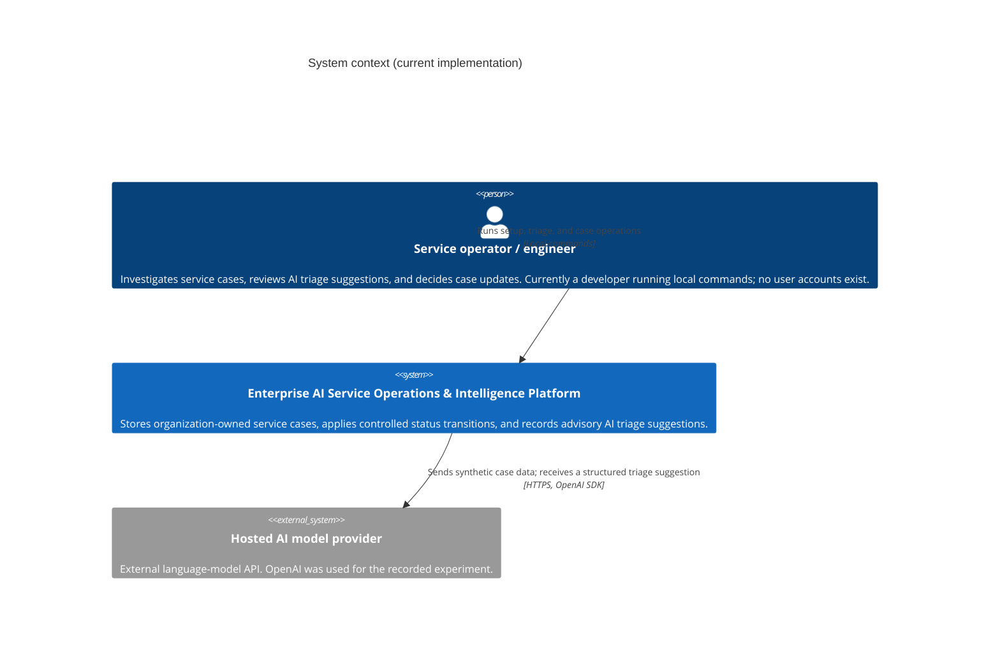
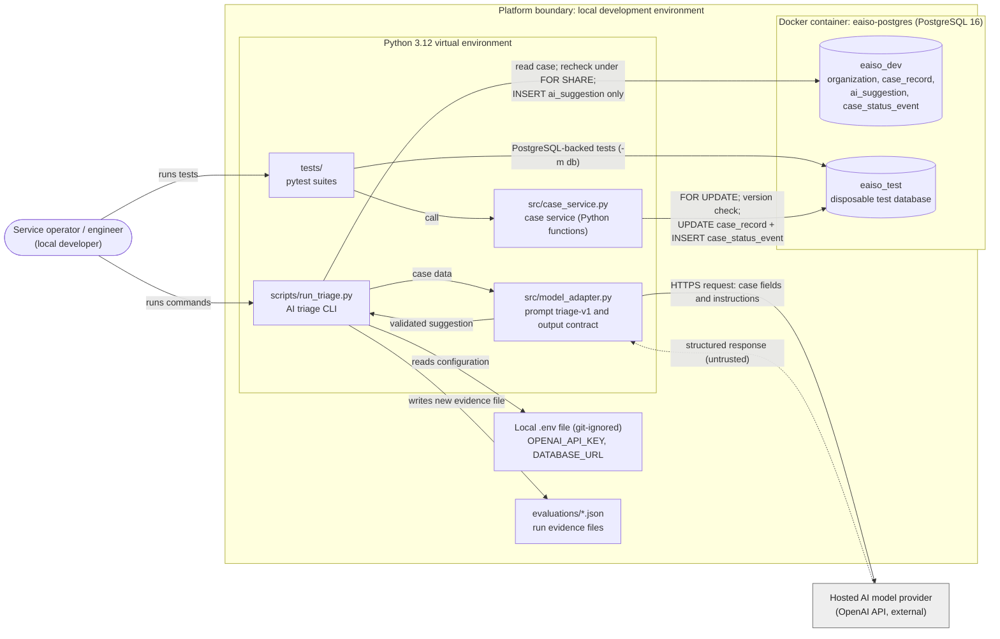

# System Context

**Project:** Enterprise AI Service Operations & Intelligence Platform  
**Status:** Describes the system as currently implemented: local development components, not a deployed service. Planned capabilities are listed separately and are not shown in the diagrams.

## 1. Purpose and current scope

The platform supports a technology service provider that handles support cases for several customer organizations. Its intended workflow lets an authorized engineer create a case, request a structured AI triage suggestion, review that suggestion, and apply an authorized case update through application logic. The [requirements](requirements.md) describe the full intended behavior.

The current implementation is a **local development system** built on synthetic data:

- A PostgreSQL schema for organizations, service cases, AI suggestions, and case status-transition events ([`db/001_init.sql`](../db/001_init.sql), [`db/002_case_status_events.sql`](../db/002_case_status_events.sql)), with fictional seed data ([`db/seed_dev.sql`](../db/seed_dev.sql)).
- A Python command-line experiment that requests one triage suggestion from a hosted model and stores it as a suggestion only ([`scripts/run_triage.py`](../scripts/run_triage.py), [`src/model_adapter.py`](../src/model_adapter.py)).
- A Python case service that creates and reads cases and applies controlled status transitions ([`src/case_service.py`](../src/case_service.py)).
- Automated tests and recorded evidence for each of these components.

There is no deployed service, application API, user interface, user account, or login. All organizations and cases are fictional.

## 2. System context (C4 Level 1)

| Element | C4 type | Role in the current implementation |
|---|---|---|
| Service operator / engineer | Person | The intended user is a service engineer who reviews suggestions and decides case updates. Today, the only operator is a developer running local commands against a local database. There is no authentication, and no identity is recorded. |
| Enterprise AI Service Operations & Intelligence Platform | Software system (in scope) | Owns case data and case-state decisions. Its internal parts, including the PostgreSQL database, are shown in [section 3](#3-technical-boundary-supporting-view), not here. |
| Hosted AI model provider | External software system | Produces triage suggestions on request. It has no access to the platform's database, and its output is advisory. The recorded experiment requested `gpt-4o-mini` ([`evaluations/model-run-01.json`](../evaluations/model-run-01.json)). |

Customer organizations appear in the system as data (the owning organization of each case), not as actors that interact with it. No identity provider, ticketing system, knowledge source, or other external system is integrated, so none is shown.

## 3. Technical boundary (supporting view)

This view supports the context diagram above. It is **not** a strict C4 container diagram. It shows the existing Python modules, the PostgreSQL datastore inside the platform boundary, and the external model provider. PostgreSQL is the platform's internal system of record, not a separate external business system.

Notes on the view:

- **The case service has no entry point of its own.** It is a set of Python functions (`create_case`, `get_case`, `transition_case`) that local Python code can import. So far, only its test suite calls them, against `eaiso_test`. The functions accept any PostgreSQL connection string, including one for `eaiso_dev`.
- **The triage CLI and the case service are independent.** The CLI does not call the case service, and the case service does not call the model or read `ai_suggestion`.
- **Only the triage CLI communicates with the external model**, through `src/model_adapter.py`. The request is made with `max_retries=0`, a 30-second timeout, and `store=False`. The tests simulate provider responses and make no model calls.
- **Database access** uses psycopg 3 with parameterized queries over `127.0.0.1:5432`. The container port is bound to the local machine only. The local components connect as the development account `eaiso_dev`; no least-privilege application role exists yet.

## 4. Capability status

### Implemented and tested

These capabilities exist in the repository and have recorded, observed test or experiment evidence. The evidence is local and synthetic; it is not production assurance.

| Capability | Implementation | Recorded evidence |
|---|---|---|
| Relational schema with organization ownership, valid status values, positive versions, nonblank text, and referential integrity | [`db/001_init.sql`](../db/001_init.sql) | [Schema integrity validation](../tests/schema-integrity-results.md): 11/11 checks passed |
| Structured validation of model output (fixed vocabularies, nonblank text, extra fields rejected) | [`src/model_adapter.py`](../src/model_adapter.py) | [Failure-path validation](../tests/ai-triage-failure-results.md): 18/18 selected tests passed |
| Handling of provider timeout, refusal, and incomplete responses; stale-case rejection; rollback on a database constraint error | [`src/model_adapter.py`](../src/model_adapter.py), [`scripts/run_triage.py`](../scripts/run_triage.py) | [Failure-path validation](../tests/ai-triage-failure-results.md): 18/18 selected tests passed |
| One hosted-model triage request, with the suggestion stored in `ai_suggestion` and case status and version unchanged | [`scripts/run_triage.py`](../scripts/run_triage.py) | [Recorded run](../evaluations/model-run-01.json): one synthetic case, one run. It is not an evaluation of model accuracy. |
| Forward-only, version-checked status transitions, with the status update and event insert in one transaction | [`src/case_service.py`](../src/case_service.py), [`db/002_case_status_events.sql`](../db/002_case_status_events.sql) | [Case operations validation](../tests/case-operations-results.md): 16/16 tests passed |

### Implemented, but not production-ready

These components work locally within the limits below. They must not be presented as production controls.

| Component | Boundary or limitation |
|---|---|
| Case service ([`src/case_service.py`](../src/case_service.py)) | `organization_id` filters queries but is supplied by the caller; it is not an authorization check. `actor_label` is caller-supplied text, not a verified identity or approval. The event history covers status transitions made through the service only. Direct database writers can bypass the transition policy. See [Controlled case operations](case-operations.md). |
| Case creation (`create_case`) | Each successful call inserts a new case. There is no request idempotency, so a retried call creates a second case. See [Case creation semantics](case-creation-semantics.md). |
| AI triage CLI ([`scripts/run_triage.py`](../scripts/run_triage.py)) | A local experiment over one fixed synthetic case. It makes one model call with no retry, writes one evidence file, and is not a service. See [AI triage integration](ai-triage-integration.md). |
| Model input handling | The case ID, organization slug, title, description, status, and version are sent to the external provider. There is no redaction or data-classification control, so only synthetic data may be used. |
| PostgreSQL | A single local Docker container with development-only credentials. There is no least-privilege application role, backup, recovery procedure, or monitoring. |
| Development seed script ([`db/seed_dev.sql`](../db/seed_dev.sql)) | Skips a sample case whose title already exists for its organization. This is setup behavior for development data, not an application guarantee. |

### Planned, not implemented

These capabilities are required by the [requirements](requirements.md) or architecture decisions but do not exist yet. The form of any user-facing interface has not been decided.

| Capability | Requirement or decision |
|---|---|
| Human authentication and server-side access checks | FR-02, [DEC-001](architecture-context.md#dec-001--the-application-owns-service-case-data-and-workflow-decisions) |
| Tenant (organization) authorization | FR-02, rule "Organization ownership" |
| Reviewer approval bound to a specific suggestion version, and execution of approved updates | FR-06, FR-07, [DEC-003](architecture-context.md#dec-003--only-authorized-application-operations-can-change-case-state) |
| A public or internal application API | Required before any of the above can be offered to users |
| Idempotent case creation | [ADR-0004](adr/0004-keyed-idempotent-case-creation.md) (Proposed); contract detailed in [Case creation semantics](case-creation-semantics.md) |
| Complete, attributable case history (creation, edits, review decisions, failures) | FR-03, FR-09 |
| Manual case-handling workflow when AI is unavailable | FR-08 |
| Durable background processing with duplicate-safe retries | FR-11 |
| Reporting, knowledge retrieval, simulated external actions, and repeatable deployment | FR-10, FR-12 to FR-15 |

## 5. Data flows and trust boundaries

### Data flows

1. **Database setup.** The operator applies the migrations and seed script with `psql` inside the container. These create the schema and the fictional organizations and cases.
2. **AI triage (local CLI).**
   1. The CLI reads the seed case from the database named in `DATABASE_URL`.
   2. It sends the case fields to the model provider with the `triage-v1` instructions.
   3. It validates the response against the Pydantic output contract.
   4. It rechecks the case's status and version under a shared row lock (`FOR SHARE`).
   5. Only if the case is unchanged, it inserts a new `ai_suggestion` row recording the case version, model identifier, and prompt version. It then writes a local evidence file.
   6. It does not update `case_record`.
3. **Case status transition (case service).**
   1. A local caller supplies a case ID, an organization ID, an expected version, a target status, and an actor label.
   2. The service locks the case row (`FOR UPDATE`) and compares the stored version with the expected version.
   3. It checks the transition against the forward-only policy.
   4. In one transaction, it updates `case_record` (incrementing `version`) and inserts a `case_status_event` row. If either step fails, both roll back.

### Authority rules

- **Case state is authoritative in PostgreSQL.** `case_record.status` and `case_record.version` are the system of record ([DEC-001](architecture-context.md#dec-001--the-application-owns-service-case-data-and-workflow-decisions)).
- **Model output is advisory.** A validated suggestion is stored in `ai_suggestion` and never changes case state. No code path passes a suggestion to `transition_case` ([DEC-002](architecture-context.md#dec-002--the-ai-component-produces-suggestions-not-business-actions)).
- **The local CLI is the only component that communicates with the external model.** The model has no database credentials or database access.
- **The local case service applies controlled status transitions.** It enforces the transition policy and version checks for callers that use it; the database does not enforce them.
- **Human authentication, tenant authorization, reviewer approval, and a public application API remain unimplemented.** No current component may be described as an authorized end-to-end workflow.

### Trust boundaries

| Boundary | What crosses it | Current controls | Not yet controlled |
|---|---|---|---|
| Operator to platform | Commands, case IDs, organization IDs, actor labels, case text | Local machine access only; input validation (UUID format, nonblank text, allowed transitions, positive expected version) | Authentication, tenant authorization, verified attribution, approval |
| Platform to model provider | Outbound: case fields and instructions. Inbound: model response. | HTTPS through the provider SDK; API key held in the git-ignored `.env`; 30-second timeout; prompt marks case text as untrusted; strict output validation; output stored only as a suggestion | Redaction and data-handling controls for real customer data; semantic accuracy of suggestions; provider availability |
| Application code to PostgreSQL | Parameterized SQL over a local connection | Schema constraints; transactions; row locks; expected-version checks in the case service | Least-privilege roles; protection against direct writers that bypass the case service; tamper-evident history |

## 6. References

**Architecture and design**

- [Architecture Decision Records](adr/README.md): ADR-0001 to ADR-0003 (Accepted) and ADR-0004 (Proposed), with alternatives, consequences, and revisit conditions.
- [Architecture context](architecture-context.md): architecture overview, the original DEC-001 to DEC-003 notes, and the current implementation boundary.
- [Requirements](requirements.md): functional requirements FR-01 to FR-15 and the rules that must always hold.
- [Data model](data-model.md): entities, integrity rules, and deferred decisions.
- [Controlled case operations](case-operations.md): transition policy and trust boundaries.
- [Case creation semantics](case-creation-semantics.md): current non-idempotent behavior and the proposed idempotency contract.
- [AI triage integration](ai-triage-integration.md): the suggestion-only integration boundary.
- [AI triage failure-path validation](ai-triage-failure-testing.md): failure scenarios and test setup.

**Source code**

- [`src/case_service.py`](../src/case_service.py), [`src/model_adapter.py`](../src/model_adapter.py), [`scripts/run_triage.py`](../scripts/run_triage.py).
- [`db/001_init.sql`](../db/001_init.sql), [`db/002_case_status_events.sql`](../db/002_case_status_events.sql), [`db/seed_dev.sql`](../db/seed_dev.sql).

**Recorded evidence**

- [Schema integrity validation](../tests/schema-integrity-results.md): 11/11 checks passed.
- [First model run](../evaluations/model-run-01.json): one recorded hosted-model run.
- [AI triage failure-path results](../tests/ai-triage-failure-results.md): 18/18 selected tests passed.
- [Case operations results](../tests/case-operations-results.md): 16/16 tests passed.
